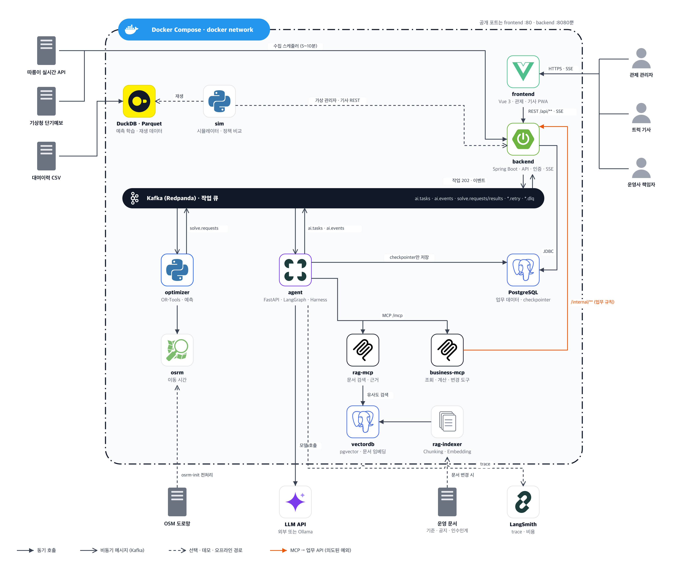

# seoul_bike
스칼라 AI 캡스톤 리포지토리

공유자전거 재배치 에이전트: Agent가 재배치 계획을 트럭 경로까지 세우고, 기사의 현장 보고로 남은 경로를 다시 짜며, 최종 결정은 사람이 내리는 운영 도구.

## 아키텍처

Docker Compose로 운영하며, 밖으로 여는 포트는 frontend(:3000) 하나다. backend(:8080)는 서버 안에서만 열리고 화면 nginx가 `/api`를 넘겨 준다. 업무 규칙과 데이터 변경은 Spring Boot 한 곳에서만 일어나고, Agent는 MCP 도구로 조회·계산·변경을 요청한다. 변경 도구는 사람이 승인하기 전까지 멈춘다.

| 계층 | 스택 |
| --- | --- |
| 화면 | Vue 3 (관제 대시보드, 기사 PWA, 성과 리포트) |
| 업무·작업 API | Spring Boot 3 (업무 API, 작업 API 202, SSE 중계, 인증 JWT, `/internal/**`) |
| Agent | FastAPI, LangGraph 1.x, LangChain 1.x, Harness, LangSmith |
| Tool | FastMCP (`business-mcp`, `rag-mcp`) |
| 계산 | OR-Tools, 수요 예측 (Python `optimizer`), OSRM |
| 대기열 | Kafka (Redpanda): `ai.*`, `solve.*`, 재시도·DLQ |
| 저장 | PostgreSQL 16 + PostGIS (업무 데이터, checkpointer), pgvector (문서 임베딩), Parquet + DuckDB |

### 아키텍처 뷰

| 뷰 | 답하는 질문 |
| --- | --- |
| [01 전체 구성도](docs/images/views/01-container.png) | 어떤 서비스가 있고 무엇과 연결되는가 |
| [02 논리 뷰](docs/images/views/02-logical.png) | 책임을 어느 계층에 두고 누가 누구를 호출하는가 |
| [03a 계획 승인](docs/images/views/03a-runtime-plan.png) · [03b 현장 보고](docs/images/views/03b-runtime-report.png) | 메시지가 어떤 순서로 오가는가 |
| [04 배포 뷰](docs/images/views/04-deployment.png) | 무엇이 어느 tier와 경계 안에서 실행되는가 |
| [05 연결 뷰](docs/images/views/05-mcp-connection.png) | 도구와 근거 문서는 어디에서 오는가 |
| [06 Harness](docs/images/views/06-harness.png) | 모델을 감싼 코드는 무엇으로 구성되는가 |

## 문서

- [계약 (API · Kafka)](docs/specs/README.md): OpenAPI·AsyncAPI 초안, [Swagger](https://baki-macbookpro.tail3286a4.ts.net/swagger)
- [역할 분담 (6인)](docs/ROLES.md): 역할별 작업, 완료 기준, 1주차 계약, 단계
- [PRD](docs/PRD.md): 문제 정의, 요구사항, 에이전트 설계
- [아키텍처](docs/ARCHITECTURE.md): 스택, 모듈 구조, 메시징, 컨테이너 구성
- [Harness 명세](docs/HARNESS.md): Harness 8요소 규칙·초기값, 진행 이벤트, 실패 코드, 시나리오 평가셋 (코드 `agent/`)
- [MCP 명세](docs/MCP.md): business-mcp 도구 11개, rag-mcp 검색(pgvector)·Resource·색인기, 승인 전달 (코드 `business-mcp/`, `rag-mcp/`, 근거 문서 [docs/evidence](docs/evidence/README.md))
- [품질 매핑](docs/QUALITY.md): ISO/IEC 25010:2023 품질 특성별 측정 방법과 증거
- [OR-Tools 파이프라인 가이드](docs/or-tools/README.md)
