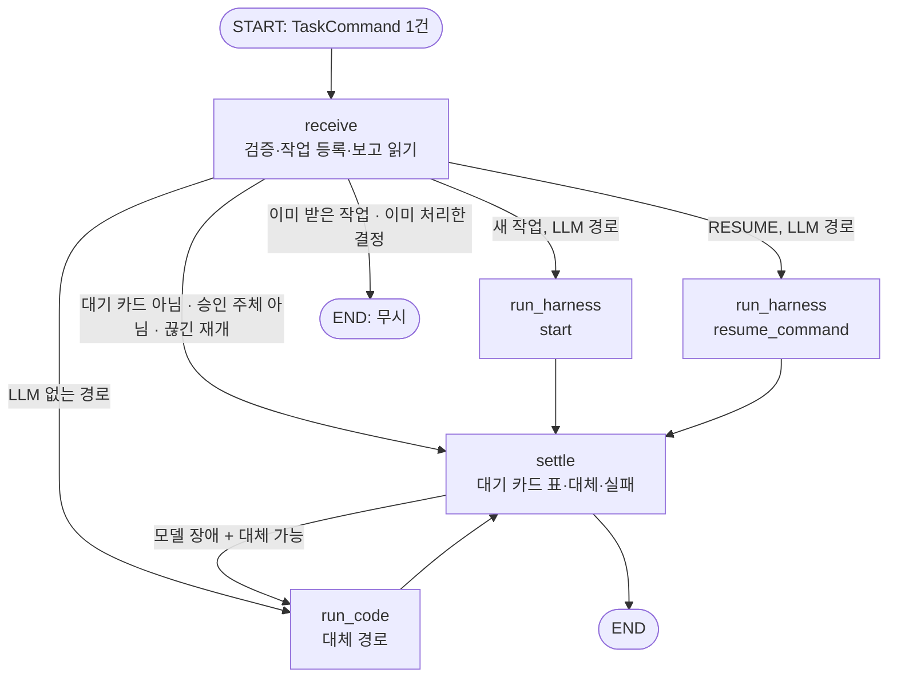

<!--
Author: Jung Minkyu
Date: 20OCT2026
Purpose: 1 에이전트 그래프(근무조 그래프) 명세. 무엇을 어떻게 만들었고, 그렇게 한 근거가 무엇인지 적는다.
-->

# 근무조 그래프 명세: 공유자전거 재배치 에이전트

| 항목 | 내용 |
| --- | --- |
| 담당 | 1 에이전트 그래프 |
| 문서 상태 | 초안 v0.9 (2026-10-22, 추론 기록·관리자 로그 추가: specs openapi 0.16 · asyncapi 0.6. 그 밖의 기준은 v0.8과 같다) |
| 코드 | [`agent/graph/`](../agent/graph/), 화면 [`frontend/src/features/approval/`](../frontend/src/features/approval/), [`frontend/src/features/task-console/`](../frontend/src/features/task-console/) |
| 함께 읽을 문서 | [specs](specs/README.md) (기준), [HARNESS](HARNESS.md) 1.4·1.5·7.3, [ISSUES](ISSUES.md), [ROLES](ROLES.md), [PRD](PRD.md) 6장. 팀 결정은 [ARCHITECTURE](ARCHITECTURE.md) 13절 D 번호로 적는다 |

> 한 장 요약(끝난 것·남은 것·확인 방법)은 [roles/01-status.md](roles/01-status.md)에 있다.
>
> 이 문서는 "어떻게 만들 것인가"와 "왜 그렇게 정했나"를 함께 적는다. 근거 열의 문서·절 번호를 따라가면 판단을 다시 확인할 수 있다.

---

## 1. 무엇을 만드는가

### 1.1 역할 경계 (HARNESS v0.5 1.5)

근무조 그래프는 **agent 서버의 바깥 껍질**이다. Harness v0.5(팀 main PR #7·#8)부터 계약 처리 대부분을 Harness가 맡는다: `TaskCommand` → `Task`(`task_from_command`), RESUME → 결정(`resume_command`), 승인 카드와 승인 순서(`requiredApprovers`, 큰 변경 두 장), 계약 모양 이벤트(`ProgressEvent.to_json()`), 변경 도구에 `approval_id`·`task_id` 넣기, 근거(`sources`). 그래프는 그 바깥을 맡는다.

| 하는 일 | 근거 |
| --- | --- |
| `ai.tasks`(TaskCommand) 소비, 계약 검사, 중복 거르기, 근무조별 순서 | HARNESS 1.5 "`ai.tasks` 소비", asyncapi `eventId`·키 규칙 |
| 현장 보고 읽기(명령의 `report` 또는 `get_field_reports`) → `FieldReport.from_contract`, `brief` 작성, `task_from_command`·`resume_command` 호출 | HARNESS 1.4 표, 7.3 |
| Harness 이벤트를 `ai.events`로 발행 (`EventSink`) | HARNESS 1.5, asyncapi `TaskEventMessage` |
| 대기 카드 표: 작업 사이 대체(G10), 재시작 뒤 카드 단계(ISS-19), 늦은·다른 주체 결정은 실행하지 않고 FAILED로 닫기 | openapi 409·403, ISSUES ISS-19 |
| RESUME 정리: 승인자 의견 마스킹·감싸기(ISS-20), 거점 제외는 계획 카드에서만 | HARNESS 3.6, openapi `ApprovalDecision` |
| 계획 카드 보강: 트럭별 경로(`routes`, 확장 G9)와 포기·제외 사유 | 화면 '일부 제외' (UR-04) |
| LLM 없이 도는 대체 경로 (계획 초안, 메모 없는 현장 보고) — 카드·결정은 Harness와 같은 함수 | HARNESS 1.5 "LLM 없는 대체 경로(NFR-03)" |
| 상태 저장·재개 (PostgreSQL checkpointer) | ROLES 1 "checkpointer 저장, 같은 `thread_id`로 재개" |
| 추론 기록(`ai.traces`) 발행: 경로 판단(ROUTE), LLM 없는 경로의 규칙 판단, Harness가 남긴 모델 판단을 관리자 로그로 (10절) | 관리자가 "모델이 어떤 도구를 왜 골랐는지" 본다. 작업 진행 이벤트와 따로 간다 |
| 화면: 관제 작업 화면, 승인 카드 컴포넌트 | ROLES 1 체크리스트, ROLES 4절 폴더 규칙 |

**하지 않는 일:** 모델 호출·도구 선택·한도·카드 만들기·승인 순서·인자 검증·마스킹(구조)·모델 재시도(Harness, 2), 변경 등급 판정과 `FAILED` 뒤 작업 재시도 결정(backend, 4), 도구 구현(MCP, 3).

**금지 (ROLES 1):** 업무 DB 직접 쓰기 (checkpointer만), 숫자를 모델이 만들기. 그래프 코드는 숫자를 만들지 않고, 도구 결과를 옮기기만 한다.

### 1.2 왜 PRD 6.2의 14노드 그래프를 그대로 만들지 않는가

PRD 6.2는 경로 계산·변경 분류·제안 생성을 그래프의 코드 노드가 하고, 사람 입력을 `manager_review`·`await_event` 두 interrupt로 받는 설계다. 팀 코드와 명세는 다른 방향으로 움직였다.

| 사실 | 출처 |
| --- | --- |
| 모델이 `request_route_plan`·`submit_plan`·`propose_route_change`를 직접 고르고, 변경 도구 앞에서 Harness가 멈춘다 | HARNESS 1.6, 3.6 |
| 작업마다 별도 스레드 `{shift_id}:{task_id}`를 쓴다. 근무조 하나에 interrupt 하나를 두면 기사 보고가 승인 대기 계획에 막힌다 | HARNESS 3.0, ISS-03 |
| 변경 등급과 승인 순서는 backend가 정한다 (`requiredApprovers`) | internal-api v0.2 `PlanCandidate`, specs README |

그래서 그래프는 "작업 접수 → Harness 실행 → 결과 정리"다. PRD 6.1의 원칙은 그대로 지킨다: 근무조 하나 = 그래프 스레드 하나(6.1-1), 숫자는 코드만(6.1-2), 계획 변경은 사람 승인 뒤에만(6.1-3, FR-18), 기사별로 그래프를 멈추지 않음(6.1-4).

---

## 2. 그래프

### 2.1 스레드 두 층

| 층 | thread_id | 상태 | 누가 |
| --- | --- | --- | --- |
| 근무조 기록 | `shiftId` | `ShiftState`: 작업 기록, 대기 카드, 계획 상태 사본, 최근 보고. interrupt 없음 | 그래프 (1) 내부 |
| 작업 | `{shiftId}:{taskId}` = 명령의 `threadId` | 모델 대화 기록, 변경 도구 앞 interrupt | Harness (2) |

**근거:** asyncapi v0.3 (PR #9): LangGraph `thread_id`는 작업 단위 `{shiftId}:{taskId}`이고 backend가 `threadId`로 보낸다. 그래프는 명령의 `threadId`가 이 모양인지 확인하고, Harness 작업 스레드가 바로 이 값이다 (D1, ISS-03 해결). 근무조 기록은 대기 카드 표·brief·작업 사이 대체를 위한 그래프 내부 기록이고 interrupt가 없어 작업끼리 대기 승인이 섞이지 않는다. 계획의 원본은 backend DB다 (G17). 같은 checkpointer(PostgreSQL)를 같이 쓴다.

### 2.2 노드

TaskCommand 1건 = 근무조 스레드에서 그래프 1회 실행이다. 근무조 그래프 안에는 interrupt가 없다. 사람을 기다리는 일은 작업 스레드(Harness)나 LLM 없는 경로의 작업 기록(`pending`)이 하고, 근무조 그래프는 "누가 무엇을 기다리는지"를 `ShiftState.approvals`에 적어 둔다.



| 노드 | 하는 일 | 근거 |
| --- | --- | --- |
| `receive` | 명령 검증, 작업 등록(`tasks`), 보고 읽기, RESUME이면 `approvalId`가 대기 중인지·결정자가 카드 승인자인지 확인, 경로 선택. 실행하지 않을 결정은 settle로 보내 FAILED로 닫는다. 같은 작업이 다시 오면 기록이 `DONE`·`WAITING_APPROVAL`일 때만 버리고 `RUNNING`(앞선 처리가 끊김)·`FAILED`면 다시 한다 | asyncapi TaskCommand, openapi 409·403 |
| `run_harness` | `task_from_command`로 `Task`를 만들어 `start` 또는 `resume_command`. 실패와 카드 이벤트는 잠시 잡아 두고(3.3), 카드는 보강해 내보낸다 | HARNESS 7.3 |
| `run_code` | LLM 없이 도구를 코드로 불러 같은 결과를 만든다 (4절) | HARNESS 1.5, PRD NFR-03 |
| `settle` | `APPROVAL_REQUIRED`면 대기 카드 표에 적고 다른 작업의 같은 대상 카드를 대체, `DONE`이면 계획 상태 정리, `FAILED`면 대체 경로 판단 후 잡아 둔 실패를 내보내거나 버린다 | HARNESS 3.7, G10 |

### 2.3 상태 (`ShiftState`)

| 필드 | 내용 | 쓰는 노드 |
| --- | --- | --- |
| `shift_id` | 근무조 | `receive` |
| `command`, `current`, `route` | 이번 실행의 명령 원문, 다루는 `taskId`, 다음 노드 | `receive`, `settle` |
| `tasks` | `taskId` → 종류, 상태(RUNNING·WAITING_APPROVAL·DONE·FAILED), 처음 명령 원문(`task_from_command`용), 보고 값, 경로(harness·code), 시도 횟수, 제외한 대여소, 이번 RESUME, LLM 없는 경로의 대기 상태(`pending`: 멈춘 호출·근거 도구 결과·카드 단계) | 전 노드 |
| `approvals` | `approvalId` → 작업, 승인 카드(보강된 것), 상태(PENDING·DECIDED·SUPERSEDED) | `settle`, `receive` |
| `plan` | `{active, proposed}`: 활성 계획과 승인 대기 계획 ID | `settle` |
| `reports` | 최근 현장 보고 10건 (기사 앱 값) | `receive` |
| `outcome` | 이번 실행의 결과 (JSON) | `run_*`, `settle` |

**근거:** 상태 요약(`brief`)은 그래프가 코드로 만든다(HARNESS 1.4). 대기 카드 표는 작업 사이 대체(G10)와 재시작 뒤 카드 단계(ISS-19)에 필요하다. 체크포인트는 감사 로그가 아니다(PRD 6.8-2): 업무 기록의 원본은 backend가 `ai.events`를 받아 저장한다.

---

## 3. 메시지 매핑

### 3.1 TaskCommand → Harness `Task`

`harness.contract.task_from_command`를 쓴다. 그래프는 그 앞에서 다음을 채운다.

| 채우는 것 | 어떻게 | 근거 |
| --- | --- | --- |
| `report` | 명령의 `report`(확장 G2)가 있으면 그 값, 없으면 `get_field_reports`에서 `reportId`로 찾아 `FieldReport.from_contract` | HARNESS 1.4 "그래프가 `reportId`로 보고를 읽어 넘긴다" |
| 기사 트럭 | `requestedBy.truckId`(asyncapi v0.3 필수, 기사가 아니면 null). null이면 보고의 `truckId`. 둘 다 없으면 Harness를 부르지 않고 `FAILED(OUTPUT_INVALID)` | NFR-06, ISS-04 해결 |
| PLAN_DRAFT 입력 | `text`가 없으면 "이번 근무조의 재배치 계획 초안을 만들어 주세요." | backend는 PLAN_DRAFT에 `text`를 싣지 않는다 |
| `brief` | `ShiftState`에서 코드로 작성 (활성·대기 계획, 대기 카드, 최근 보고) | HARNESS 1.4 |
| `driver_names` | 설정 `AGENT_DRIVER_NAMES` (계약에 이름 목록이 없다) | 자유 글 속 이름 가리기 |

### 3.2 RESUME → Harness `resume_command`

| 경우 | 그래프가 하는 일 | 근거 |
| --- | --- | --- |
| `approvalId`가 대기 중이 아님 | Harness를 부르지 않는다. 작업이 이미 다음 카드·완료·실패로 갔으면(재전달, 대체된 카드) 이벤트 없이 버리고, 아니면 `FAILED`(`INTERNAL_ERROR`)로 닫는다. 승인 처리 도중 끊긴 작업이 다시 와도 변경이 이미 실행됐을 수 있어 다시 하지 않고 `FAILED` | openapi 409. backend가 먼저 막지만 그래프도 한 번 더 막는다. backend는 결정을 받으며 작업을 RUNNING으로 바꾸므로 이벤트가 없으면 멈춘다 (PR #11 리뷰) |
| `decidedBy.role`이 카드 `approver`와 다름 | Harness를 부르지 않고 `FAILED`(`INTERNAL_ERROR`)로 닫는다. backend는 그 결정으로 승인을 끝냈으므로 카드를 다시 기다리지 않는다 | backend `canBeDecidedBy`(403 NOT_APPROVER)와 같은 규칙 |
| `comment` | 기사 이름·연락처를 가리고 `<user_input>`으로 감싸서 넘긴다 | Harness `decision_from_resume`은 의견을 그대로 모델에게 넘긴다 (ISS-20) |
| `excludeStationIds` | 계획 카드에서만, ID 모양(`[A-Za-z0-9_-]`)만 넘긴다. Harness가 "빼고 다시 계산"으로 바꾼다 | openapi "계획 승인에서 일부 대여소를 빼고", UR-04 |
| 경로 변경 카드 | 카드의 단계(`requiredApprovers`에서 `approver`의 위치)를 Harness `_steps`에 되돌린 뒤 넘긴다. 같은 프로세스면 그대로 둔다 | ISS-19: Harness는 단계를 메모리에만 둔다. 재시작하면 기사 카드에 대한 결정이 관리자 카드로 비교돼 무시된다 |
| Harness가 `ApprovalMismatch` | 아무것도 실행하지 않고 `FAILED`(`INTERNAL_ERROR`)로 닫는다 | HARNESS 5절: 불일치는 호출한 쪽이 처리한다 |

큰 변경의 관리자 승인 → 기사 카드, 앞 카드 거절 → 뒤 카드 없음, 마지막 카드 ID로 변경 실행은 Harness `resume_command`가 한다 (asyncapi v0.2, internal-api v0.2).

### 3.3 이벤트

Harness가 계약 모양(`TaskEventMessage`, `seq` 없음)으로 만든다. 그래프는 그대로 `ai.events`에 내보내되, Harness 한 구간이 도는 동안 두 가지만 잡아 둔다.

| 잡아 두는 것 | 왜 | 처리 |
| --- | --- | --- |
| `FAILED` | 모델 장애면 LLM 없는 경로로 다시 하므로 실패가 먼저 나가면 안 된다 | 대체하면 버리고, 아니면 내보낸다 |
| `APPROVAL_REQUIRED` | 계획 카드에 트럭별 경로·사유를 붙인다 (3.4) | 보강해 같은 `eventId`로 내보낸다 |
| `DONE` | 빠진 문서 근거를 채운다 (3.5, ISS-23) | 보강해 같은 `eventId`로 내보낸다 |

FAILED의 실패 종류는 계약 필드 `code`로 올린다 (openapi v0.4 `TaskEvent.code`). Harness는 아직 `harness.code` 확장에 두고, backend는 계약 밖 필드를 버리므로 올리지 않으면 사라진다. 그래프가 직접 내는 이벤트: LLM 없는 경로의 TOOL·카드·DONE, 다른 작업의 카드를 대체할 때 옛 작업의 `DONE`, 계약 위반 명령의 `FAILED`. 모두 `harness.ProgressEvent`로 만든다. ID 속 U+2010·U+2011 하이픈은 내보내기 전에 `-`로 바꾼다 (gpt-oss가 `ST‑2001`처럼 쓴다). 한 줄 대기열로 키 `shiftId`(같은 파티션)에 발행하므로 backend가 매기는 순번이 곧 내보낸 순서다 (D7).

### 3.4 승인 카드 (`ApprovalRequest`)

`harness.contract.approval_card`가 만든다: `approvalId`(작업·도구 호출·승인자로 정해지는 UUID), `kind`, `approver`, 경로 변경이면 `grade`·`candidateId`·`requiredApprovers`·`diff`, 제목 "TR-1 경로 변경 (큰 변경, 관리자 승인 1/2)". LLM 없는 경로도 같은 함수를 쓴다.

그래프는 **계획 카드**만 보강한다: `routes`(트럭별 경로, 확장 G9)와 사유("포기 ST-2001: 트럭 시간·적재량 한계", "제외한 대여소: ST-2005"). 값은 `request_route_plan` 결과와 근무조 상태의 제외 목록을 옮긴 것이다.

### 3.5 근거 (`sources`)

Harness(`harness.contract.sources`)가 작업 대화의 도구 결과에서 만든다. LLM 없는 경로도 같은 함수를 쓴다. 다만 실제 rag-mcp의 `search_docs`는 `{chunks: [...]}`(MCP 명세 4.1)를 주고 Harness는 목록 모양만 읽어서 문서 근거가 빠진다. 그래서 그래프가 DONE을 잡아 두었다가 chunk를 `Source{kind: DOC, title: "제목 · 절", uri: doc://…#절, excerpt}`로 채워 내보낸다 (ISS-23). Harness가 고치면 중복만 걸러진다.

---

## 4. LLM 없이 도는 경로 (NFR-03)

| 작업 | 언제 | 코드가 하는 일 |
| --- | --- | --- |
| PLAN_DRAFT | 모델이 없거나(`AGENT_LLM=none`) Harness가 `MODEL_UNAVAILABLE`·`MODEL_ERROR` | `request_route_plan(kind=PLAN)` → 계획 카드 → 승인되면 `submit_plan`, 제외 요청이면 `exclude_station_ids`로 다시 계산 |
| FIELD_REPORT | 메모가 없을 때, 또는 위와 같은 모델 장애 | 진입 불가·공사면 그 대여소를 빼고 `request_route_plan(kind=REPLAN, truck_ids=[트럭])` → 등급 NONE이거나 차이가 없으면 "그대로" → 아니면 `requiredApprovers` 순서로 경로 변경 카드 → 마지막 카드까지 승인되면 `propose_route_change` |
| REQUEST · QUESTION | 모델이 없을 때 | 자연어 해석이 필요하므로 `FAILED(MODEL_UNAVAILABLE)` |

**지키는 것**
- 카드·승인 순서·결정 변환은 `harness.contract`의 `approval_card`·`approvers`·`decision_from_resume`을 그대로 쓴다. 그래서 모델 경로와 카드 모양·`approvalId`·두 장 순서가 같다.
- 변경 도구는 마지막 카드까지 승인된 뒤에만 부르고, 그 카드의 `approval_id`와 `task_id`를 넣는다 (internal-api `ApprovedChange`).
- 도구는 tool call 형태로 불러 오류(`status=error`, 예: backend 403·409)를 실패로 가린다. MCP 어댑터는 오류를 예외가 아니라 `"Error executing tool …"` 글로 돌려주기 때문에, 그냥 부르면 거부된 변경을 "실행했다"고 답하게 된다 (ISS-21, 실제로 겪었다).

**근거:** PRD NFR-03 "LLM이 실패해도 계획 생성·승인·보고·재경로의 핵심 흐름은 동작. 설명은 템플릿 문장으로 대체", HARNESS 1.5, HARNESS 10절 "`field_report` 10초 … 메모 없는 보고는 LLM을 거치지 않게".

---

## 5. 운영

| 항목 | 정한 것 | 근거 |
| --- | --- | --- |
| 모델 | Harness 설정(`harness.yaml`, D25: Ollama Cloud `gemma4:31b`·`gpt-oss:120b`)을 그대로 쓴다. 덮어쓰기: `AGENT_LLM=none`(대체 경로만), `AGENT_LLM=ollama:<모델>`, `AGENT_LLM=openai:<모델>`(서버는 `openai:gpt-4.1-mini`, `OPENAI_API_KEY`). 덮어쓰면 대체 모델은 끈다 | 모델 선택은 Harness 설정(2). 키는 `agent/.env`의 `OLLAMA_HOST`·`OLLAMA_API_KEY` |
| 기사 이름 | `AGENT_DRIVER_NAMES`(쉼표 구분)로 받아 자유 글(질문·메모·승인자 의견)에서 가린다 | 계약에 이름 목록이 없다. 구조 필드는 Harness `mask_keys`가 가린다 |
| 도구 | `MCP_BUSINESS_URL`·`MCP_RAG_URL`(Streamable HTTP, Harness `mcp_client`). `MCP_FAKE=1`이면 평가용 가짜 MCP(메모리 전송, compose 기본은 `0`), `MCP_FAKE_GRADE`로 변경 등급 고정. 가짜 MCP는 backend `/internal`도 흉내 내므로 RESUME 승인을 가짜 MCP에도 기록한다 (`wiring.record_approvals_in`) | 통합 확인용. 결과는 예시 데이터이고 backend는 바뀌지 않으므로 시연에는 쓰지 않는다 |
| 체크포인터 | PostgreSQL(`AGENT_PG_URL`). 근무조·작업 스레드를 같이 저장. **DB 인코딩은 UTF8**이어야 하고, 아니면 열 때 멈춘다 | ROLES 1. SQL_ASCII(예: `LC_ALL=C` initdb)면 psycopg가 문자열을 bytes로 돌려주고 LangGraph가 그 값을 thread_id로 다시 써서, 재개한 실행이 엉뚱한 스레드에 저장된다(오류 없음). 실제로 겪었다 |
| 중복 | TaskCommand `eventId`를 처리 기록(`agent_processed_events`)에 남기고 다시 오면 버린다. `FAILED`로 끝난 명령은 남기지 않는다 (G11). 같은 `taskId`가 다른 `eventId`로 오면 작업 기록을 본다: `DONE`·`WAITING_APPROVAL`이면 버리고, `RUNNING`(앞선 처리가 끊김)이면 처음부터 다시 한다 | asyncapi 공통 규칙. 처리 도중 끊긴 작업을 버리면 FAILED 없이 멈춘다 (PR #11 리뷰) |
| 계약 위반 명령 | 바로 `ai.tasks.dlq`. 어느 작업인지(`taskId`·`shiftId`) 알면 `FAILED`(`INTERNAL_ERROR: 계약에 맞지 않는 명령…`)도 보낸다 | 안 보내면 backend 작업이 QUEUED에 멈춘다. 실제로 `reportId` 없는 FIELD_REPORT에서 확인했다 (G13) |
| 승인 확인 | 변경 도구 인자 `approval_id`(마지막 카드)·`task_id`를 Harness가 채운다(모델에게는 숨김). LLM 없는 경로도 같은 값을 넣는다 | internal-api `ApprovedChange`, harness.yaml `injected_args`, ISS-17 (G8 해결) |
| 순서 | 키 = `shiftId`. 한 근무조의 명령은 한 번에 하나씩, 이벤트는 한 줄 대기열로 발행 | asyncapi "같은 파티션에서 순서대로" |
| Kafka 압축 | `aiokafka[snappy,lz4,zstd]`(cramjam)로 압축된 메시지도 읽는다 | 없으면 압축된 메시지 하나를 꺼내다 죽고, 재시작해도 같은 메시지에서 또 죽는다. `rpk topic produce`(기본 snappy)로 실제로 겪었다 (G15) |
| 재시도 | 처리 중 예외(브로커·DB 장애)는 `ai.tasks.retry`로 다시 넣고 3회 넘으면 `ai.tasks.dlq`와 `FAILED`(`INTERNAL_ERROR`). 작업 실패는 `FAILED` 이벤트로 끝내고 backend가 재시도 여부를 정한다 | asyncapi "`<토픽>.retry` → `.dlq`", HARNESS 3.7 |
| 이벤트 발행 | 발행이 실패하면 그 이벤트를 될 때까지 다시 보낸다 (0.5초에서 시작해 최대 10초 간격). 다 보낸 뒤에만 오프셋을 커밋한다 | 버리면 마지막 이벤트(DONE·FAILED)가 사라져 작업이 멈춘다. 뒤 이벤트를 먼저 보내면 화면 순서가 바뀐다 |
| 준비 확인 | MCP 도구를 읽고 Kafka에 붙은 뒤 `/tmp/agent-ready`(`AGENT_READY_FILE`)를 10초마다 갱신한다. compose healthcheck가 30초 안에 바뀌었는지 본다 | 크래시 루프를 `docker compose up --wait`가 잡게 (PR #11 리뷰) |
| 추론 기록 | `ai.traces`(키 `shiftId`)로 보낸다. 따로 연 producer(`acks=1`)와 한도 있는 대기열(2,000건)을 쓰고, 대기열이 차거나 5초 안에 못 보내면 버린다. 커밋 전에 기다리지 않는다. `AGENT_TRACE=0`이면 끈다 | 관리자 로그는 최선 노력이다. 이 통로가 막혀도 작업·`ai.events` 순서·오프셋 커밋이 그대로여야 한다 (10.4) |

---

## 6. 화면

팀 공통 뼈대(`frontend/`, PR #4)의 `api` 클라이언트와 `useTaskStream()`을 그대로 쓴다. `src/shared`는 고치지 않는다 (ROLES 4절: 4의 승인 필요). 스타일은 컴포넌트 안(`<style scoped>`)에만 둔다.

| 컴포넌트 | 폴더 | 하는 일 |
| --- | --- | --- |
| 관제 작업 화면 | `frontend/src/features/task-console/TaskConsoleView.vue` | 요청 입력(계획 초안·상황 반영 요청·질의. 현장 보고 재경로는 기사의 `POST /api/reports`로만 생긴다, G13), 작업 목록, 답변, 근거, **진행 이벤트 로그**(TOOL·APPROVAL_REQUIRED·DONE·FAILED, TOKEN은 답변으로 모음), 승인 카드 자리 |
| 승인 카드 | `frontend/src/features/approval/ApprovalCard.vue` | `ApprovalRequest` 하나. 승인(기사 카드는 '수락')·거절(사유)·일부 제외(계획 카드만). 트럭별 경로(G9)와 경로 차이(`diff`)를 보여 준다. 기사 화면(2)도 그대로 쓴다 |
| 승인 표시 규칙 | `frontend/src/features/approval/approval.ts` | 승인 단계, 뺄 수 있는 대여소, `ApprovalDecision` 몸통. **결정 권한은 판단하지 않는다**: 버튼은 늘 보이고 승인 주체가 아니면 backend 403 `NOT_APPROVER`를 카드에 보여 준다 (과제 금지 사항 "Vue의 권한 판단", PR #11 리뷰) |

ROLES 4절 "승인 카드는 M2에서 `task-console` 안에 임시로 있다. 1이 `approval`로 옮긴다"를 이렇게 끝냈다. 이전에 만든 미리보기(`agent/ui`)와 backend 대역(`graph/devserver.py`)은 실제 backend·frontend가 생겨서 버렸다.

---

## 7. 계약 확인 결과 (specs README의 질문)

> "`TaskCommand`·`TaskEvent` 필드로 LangGraph 시작·재개·이벤트 발행이 충분한가" (담당: 에이전트)

**03a는 충분하다. 03b(현장 보고)는 backend 작업 API로는 막혀 있다(G13).** 실제 backend(main `3428c52`)와 붙여 본 결과다. 같은 질문 일부는 Harness [이슈 기록](ISSUES.md)에도 있다.

| # | 내용 | 지금 처리 | 제안 · 결정 |
| --- | --- | --- | --- |
| G1 | `requestedBy`에 기사의 `truckId`가 없다 | **해결 (PR #9):** `requestedBy.truckId` 필수 (기사가 아니면 null). 명령에 키가 없으면 계약 위반 | D2 |
| G2 | FIELD_REPORT에 `reportId`만 있어서 보고 값을 도구로 다시 읽어야 한다 | `get_field_reports`로 읽는다 | 명령에 보고 값(`report`)을 같이 싣기 (D2, 재경로 10초) |
| G3 | 스케줄러가 만든 PLAN_DRAFT의 `requestedBy`가 사람 형식만 허용한다 | Harness `task_from_command`가 MANAGER·DRIVER·EXECUTIVE만 받아 지금은 관리자로 들어간다 | `requestedBy.kind: scheduler` 허용 |
| G4 | 일부 제외를 APPROVE·REJECT 어느 쪽에 싣는지 정해지지 않았다 | 둘 다 "빼고 다시 계산"으로 본다 (3.2). 화면은 REJECT로 보낸다 | 설명에 한 줄 추가 (D3) |
| G5 | 근무조 종료 작업이 없다 (PRD 6.2 `shift_end`) | 다루지 않음 | D10 |
| G6 | 도구 계약이 두 곳에서 다르다 | **해결 (Harness v0.5):** 평가용 가짜 MCP가 internal-api 모양으로 바뀌었다 | 실제 business-mcp(3)도 같은 모양으로 |
| G7 | `TaskEvent.tool.name`이 접두어 포함(`business_get_risk_stations`) | Harness 이름 그대로. backend 가짜 에이전트도 같다 | 그대로 |
| G8 | 변경 API의 `approvalId`·`taskId`를 MCP 도구 인자에 어떻게 실을지 | **해결 (Harness v0.5):** 숨긴 인자 `approval_id`·`task_id`를 Harness가 채운다. 그래프의 `X-Approval-Id` 헤더는 버렸다 | ISS-17 (3과 합의) |
| G9 | 계획 승인 카드에 경로가 없어 화면이 '일부 제외'할 대여소를 고를 수 없다 | 카드에 `routes`(openapi `Route` 모양)를 더 싣는다. 화면 타입은 `ApprovalRequest & {routes?}` | `ApprovalRequest.routes` 추가 (D4) |
| G10 | 다른 작업의 대기 승인이 새 카드로 대체될 때 | 옛 작업에 `DONE`("새 승인 요청으로 대체")을 보낸다. backend는 DONE에서 그 작업의 대기 승인을 SUPERSEDED로 바꾸고, 늦은 결정에 409 | 같은 작업 안의 대체는 backend가 이미 한다. 작업 사이 대체 표시는 D13 |
| G11 | backend가 `FAILED` 뒤 같은 명령을 다시 넣으면 `eventId`가 같다 | `FAILED`로 끝난 명령은 처리 기록을 남기지 않는다 | 그대로 두거나 재시도마다 새 `eventId` |
| G12 | `seq`를 누가 매기나 | **해결 (PR #4):** backend가 매긴다. agent는 보내지 않는다 | D7을 이 내용으로 닫기 |
| G13 | **openapi `CreateTaskRequest`에 `reportId`가 없는데 asyncapi FIELD_REPORT는 `reportId` 필수.** backend는 관리자의 FIELD_REPORT 작업을 받아 `reportId` 없이 보내고, 기사는 FIELD_REPORT 작업을 만들 수 없다(403), `POST /api/reports`는 아직 없다(404) | 계약 위반으로 DLQ + `FAILED`로 끝낸다 (5절) | FIELD_REPORT는 `POST /api/reports`로만 만들고 작업 API에서는 막기 (4와 합의, M4) |
| G14 | 경로 변경 승인 = 기사 수락, 큰 변경은 관리자 → 기사 두 장 | **해결 (PR #6, Harness v0.5):** Harness·LLM 없는 경로 모두 `requiredApprovers` 순서. 재시작 뒤 단계는 그래프가 보존 (ISS-19) | 3 MCP가 `request_route_plan` 결과에 `candidateId`·`grade`·`requiredApprovers`·`diffs`를 넘기기 |
| G15 | Kafka 메시지 압축을 정하지 않았다 | agent는 snappy·lz4·zstd·gzip을 모두 읽는다 | 압축 여부·방식을 asyncapi 공통 규칙에 한 줄 (ISS-22) |
| G16 | 승인자 의견이 모델에게 그대로 간다, MCP 도구 오류가 글로 돌아온다 | 그래프가 의견을 가리고 감싼다(ISS-20). LLM 없는 경로는 tool call로 불러 오류를 가린다(ISS-21) | Harness `decision_from_resume`이 의견을 직접 처리 (2) |
| G17 | specs README "근무조 상태(계획)의 원본은 DB" | 그래프는 근무조 기록(`shiftId`)에 대기 카드·최근 보고·계획 사본을 둔다. 원본은 backend이고, 사본은 brief와 작업 사이 대체(G10), 재시작 뒤 카드 단계(ISS-19)에만 쓴다 | 이 내부 기록을 허용하는지 팀 확인. 안 되면 brief는 조회 도구로, 대체는 backend 409에 맡긴다 |

---

## 8. 실행과 확인

### 8.1 단위 테스트 (키·브로커 없이)

```bash
cd agent
../.venv/bin/python -m unittest discover tests        # Harness 38 + 그래프 35 (+ PostgreSQL 1, 주소 없으면 건너뜀)
AGENT_TEST_PG_URL='postgresql://user:pw@127.0.0.1:5432/agent_test' ../.venv/bin/python -m unittest tests.test_graph_postgres
../.venv/bin/python -m evaluation --out /tmp/eval.md  # Harness 평가셋 14개
cd ../frontend && npm ci && npm run build             # 화면 타입 검사(vue-tsc)와 빌드
```

테스트는 Harness와 같은 방식으로 돈다: 실제 MCP 프로토콜(메모리 전송)의 가짜 MCP 서버([`evaluation/fake_mcp.py`](../agent/evaluation/fake_mcp.py))와 정해진 순서로 답하는 스크립트 모델.

| 파일 | 확인하는 것 |
| --- | --- |
| `tests/test_graph.py` | 03a(승인 전 실행 없음, 승인 뒤 `approval_id`와 함께 활성화, 일부 제외 → 새 카드, 늦은 결정 무시, 작업 사이 대체, 승인 주체 확인, 의견 마스킹·감싸기, 제외 ID 검사), 03b(메모 없는 MINOR → 기사 한 장, MAJOR → 관리자 → 기사, 앞 카드 거절 → 뒤 카드 없음, NONE → 그대로, 기사 범위, **재시작 뒤 기사 카드로 재개(ISS-19)**, **backend가 거부한 변경을 실행했다고 답하지 않음(ISS-21)**), 승인 대기 중 보고 처리(PRD 6.1-4), 모델 장애 → 대체 경로(FAILED 안 나감), 모델 없는 운영, 모든 이벤트가 asyncapi `TaskEventMessage` 스키마에 맞음, 하이픈, 명령 검사, 기사 이름 마스킹, brief, 일꾼(중복, DLQ → FAILED, 재시도, FAILED 미기록, 계약 위반 → FAILED, **처리 도중 끊긴 작업의 재시도는 다시 실행**, **승인 처리 도중 끊긴 재개는 두 번 실행하지 않고 FAILED**, 발행 실패는 될 때까지 다시), 대기 카드가 아닌 결정 → FAILED |
| `tests/test_trace.py` | 추론 기록: 모델이 적은 `rationale`이 MCP·카드·체크포인트에 가지 않음, 같은 호출 한도가 이유가 달라도 그대로, 구간별 기록 순서(시작 → 판단 → 도구 → 승인 대기 → 끝), 재시도·대체 모델, 고를 수 있는 도구와 빠진 도구(이유), 기사 개인정보 미노출, 기록 통로가 망가져도 작업·이벤트가 같음, 경로 판단·규칙 판단, 모든 기록이 asyncapi `AgentTraceMessage` 스키마에 맞음, `TracePump`는 다시 보내지 않고 버림, CLI 출력 |
| `tests/test_graph_postgres.py` | 1번 프로세스에서 승인 대기 → 2번 프로세스에서 승인 → 같은 도구 호출이 실행되고 같은 작업으로 이벤트가 이어진다. UTF8 DB 필요 (SQL_ASCII면 체크포인터가 열 때 멈춘다) |

### 8.2 통합 확인 (실제 backend · Kafka · 화면)

agent는 compose 서비스 `agent`([`agent/Dockerfile`](../agent/Dockerfile))로 backend·redpanda·PostgreSQL과 함께 뜬다. 공개 포트는 없다. 브로커는 `redpanda:9092`이고, 체크포인터·처리 기록은 같은 PostgreSQL의 `agent` 데이터베이스에 둔다. 이 데이터베이스는 한 번 돌고 끝나는 `agent-db-init`이 없을 때만 만든다 (이미 있는 볼륨에도 돈다). agent는 backend가 healthy가 된 뒤 뜬다. `ai.tasks`·`ai.events`(파티션 6개)를 backend가 만들기 때문이다.

env 파일은 `infra/.env.example`을 복사해 채운다 (저장소에 넣지 않는다).

| 변수 | 통합 확인 값 | 이유 |
| --- | --- | --- |
| `FAKE_AGENT_ENABLED` | `false` | 켜 두면 backend 대역과 agent가 둘 다 답해 이벤트가 두 번 나간다 |
| `JWT_SECRET`, `SEED_USER_PASSWORD`, `POSTGRES_PASSWORD`, `VECTOR_PASSWORD` | `openssl rand -hex 32` 등 | 예시 값을 그대로 쓰지 않는다 |
| `AGENT_LLM` | `none` | `check_03a.py`는 모델 없는 경로 기준이다. 비우면 harness.yaml 모델(`OLLAMA_API_KEY` 필요) |
| `MCP_FAKE` | `0` (기본) | 실제 business-mcp·rag-mcp(3)를 쓴다. `1`은 MCP 없이 그래프만 볼 때 (예시 데이터) |
| `MCP_INTERNAL_MODE`, `INTERNAL_TOKEN` | `http`, 아무 값 | business-mcp가 backend `/internal/**`를 실제로 부른다. `fake`(기본)면 business-mcp 안의 예시 데이터로 답해 backend 계획이 바뀌지 않는다 |
| `SEOUL_API_KEY` | 열린데이터광장 키 | collector가 실시간 재고를 넣어야 실제 근무조(예: `N02:2026-10-21:EVE`)에 대여소가 있다 |

```bash
docker compose -p seoulbike-e2e -f infra/compose.yaml --env-file ~/e2e.env up -d --build --wait   # frontend·backend·agent까지
docker compose -p seoulbike-e2e logs -f agent                  # "도구 12개, 모델 none" 뒤 ai.tasks 구독
cd agent && ../.venv/bin/python e2e/check_03a.py <SEED_USER_PASSWORD> <근무조 ID>   # 03a를 HTTP로 끝까지. 마지막 줄 "E2E 03a OK". MCP_FAKE=1이면 근무조를 뺀다
docker compose -p seoulbike-e2e down -v                        # 끝나면 정리
```

화면은 compose frontend(http://localhost:3000)나 `cd frontend && npm run dev`(http://localhost:5173)로 본다. 시연 계정은 manager, 근무조는 `check_03a.py`에 준 근무조다 (가짜 MCP면 `yeongdeungpo:2026-10-24:PM`). 실제 모델로 보려면 env 파일에서 `AGENT_LLM`을 비우고 `OLLAMA_API_KEY`를 채운 뒤 `up -d agent`로 agent만 다시 만든다. agent 코드를 고쳤으면 `up -d --build agent`.

**호스트에서 agent를 돌릴 때 (디버깅용).** 덮어쓰기 [`agent/e2e/compose.override.yaml`](../agent/e2e/compose.override.yaml)이 호스트용 Kafka 리스너(127.0.0.1:19092)와 PostgreSQL 포트(127.0.0.1:55432)를 연다. compose의 agent는 먼저 멈춘다. 같은 consumer group에 둘이 남아 있으면 파티션을 나눠 가져가서 다른 쪽 코드가 명령을 처리한다 (실제로 겪었다). 실제 모델은 `AGENT_LLM`을 빼고 `set -a; . ./.env; set +a`로 Ollama 키를 읽는다.

```bash
docker compose -p seoulbike-e2e -f infra/compose.yaml -f agent/e2e/compose.override.yaml --env-file ~/e2e.env up -d --build --wait
docker compose -p seoulbike-e2e stop agent
cd agent && MCP_FAKE=1 AGENT_LLM=none KAFKA_BOOTSTRAP=localhost:19092 PGPASSWORD=<POSTGRES_PASSWORD> AGENT_PG_URL='postgresql://seoulbike@127.0.0.1:55432/agent' ../.venv/bin/python -m graph
```

### 8.3 2026-10-20 확인 결과 (main `1ecdb7a`, specs openapi 0.4 · asyncapi 0.3)

| 확인 | 결과 |
| --- | --- |
| 그래프 단위 테스트 | 30개 통과, PostgreSQL 재개 1개 통과 (UTF8 DB) |
| Harness 단위 테스트 (2) | 38개 중 37개 통과. `test_field_report_command_becomes_a_driver_task`는 옛 계약 모양 명령(`threadId=shiftId`, `truckId` 없음)을 새 스키마로 검사해 실패한다. main 그대로의 상태이고 2의 테스트다 |
| 안전장치가 실제로 걸리는지 | 재시작 단계 복원(ISS-19)·의견 정리(ISS-20)·FAILED 잡아 두기·제외 ID 검사를 하나씩 끄면 해당 테스트가 실패한다 |
| Harness 평가셋 (스크립트 모델) | 15/15 |
| 화면 | `vue-tsc` + 빌드 통과, `npm run gen:api` 뒤 `schema.d.ts` 변화 없음 (CI 검사와 같음) |
| 03a, 모델 없음, agent 컨테이너 | `check_03a.py`: PLAN_DRAFT 202 → SSE `id` 1~3 → 일부 제외 → 새 카드(4~6, "제외한 대여소" 사유) → 옛 카드 결정 409 → 승인 → `submit_plan` 실행 → DONE(7~9) → 재전송 1~9. backend가 작업 단위 `threadId`·`requestedBy.truckId`를 보낸다 |
| 03b 큰 변경 (`MCP_FAKE_GRADE=MAJOR`) | backend로 FIELD_REPORT 작업을 만든 뒤 G13이 고쳐졌을 때의 명령을 Kafka에 넣어 확인: "(큰 변경, 관리자 승인 1/2)" → 기사가 누르면 403 → 관리자 승인 → 같은 `candidateId`로 "(기사 수락 2/2)" → 관리자가 누르면 403 → TR-1 기사 승인 → `propose_route_change` 성공(backend DB `TOOL_END ok=true`) → DONE |
| 03b 작은 변경 | "(작은 변경, 기사 수락 1/1)" 한 장 → 기사 승인 → 실행 → DONE |
| 실패 종류 | 모델 없는 질의 → backend DB에 `code=MODEL_UNAVAILABLE` 저장, `harness` 확장은 저장 안 됨 |
| 실제 모델 (`gemma4:31b`, main `3428c52`에서) | 질의 5.6초(도구 1회, 근거). 계획 초안 → 카드 → 승인 → `submit_plan` 성공 → DONE 4.5초. 승인 뒤에도 "승인 요청하였습니다"라고 쓰는 문구 문제는 남음 (프롬프트, 2) |
| 03b 현장 보고, backend 작업 API | **돌지 않음** (G13). 계약 위반 명령은 FAILED(`code=INTERNAL_ERROR`)로 끝나 화면에 이유가 보인다 |
| **실제 MCP 서버** (3의 `유은/mcp` `4dd5305`, 가짜 `/internal`) | 자체 테스트 business-mcp 29·rag-mcp 13 통과. agent가 Streamable HTTP로 도구 12개를 찾음(변경 도구에 `approval_id`·`task_id`). 모델 없이: 계획 카드(트럭별 경로) → 승인 → `submit_plan` 실행 → DONE, 진입 불가 보고 → 실제 후보 "작은 변경, 기사 수락 1/1" → 기사 승인 → `propose_route_change` 실행 → DONE. 실제 모델(`gemma4:31b`): 질의가 `rag_search_docs`를 써서 문서 근거와 함께 DONE(2.3초), 계획 초안 → 승인 → 실행(4.1초) |
| 실제 backend + agent 컨테이너 + 실제 MCP | 03a: `/internal` 승인 기록이 없으면 변경 도구 403 → 작업 FAILED(이유가 화면까지), 기록이 있으면(backend `/internal` M3가 할 일) 승인 → 실행 → DONE |
| 실제 MCP와 붙이며 고친 것 | `get_field_reports`가 `{reports: [...]}`로 감싼 결과를 준다(MCP 명세 2.2) → LLM 없는 경로가 보고를 못 찾던 것. rag chunk 근거 누락(ISS-23) |
| 앞 버전에서 고친 것 | v0.4 확인의 03b "실행했습니다"는 거짓이었다: LLM 없는 경로가 MCP 오류 글을 성공으로 읽었다 (ISS-21). 이제는 backend DB의 `TOOL_END ok`로 실제 실행을 본다 |

---

## 9. 역할 1 완료 점검 (ROLES 1 체크리스트)

| 항목 | 상태 | 근거 |
| --- | --- | --- |
| `ShiftState`와 그래프: 계획 초안, 보고 해석·재경로, 상황 반영, 질의 | 완료 | `graph/shift.py` 4노드. Harness v0.5 경계에 맞춤 (카드·순서·이벤트는 Harness) |
| MCP Client로 두 서버 연결 (`business_`, `rag_`) | 완료 (3의 `유은/mcp` 브랜치 기준) | Streamable HTTP로 도구 12개를 찾고, 실제 서버로 03a·03b를 끝까지 확인 (8.3). 3 브랜치가 main에 들어오면 다시 확인 |
| 모델이 도구를 고르고 근거와 함께 답하는 노드 | 완료 (Harness와 나눔) | 실제 모델로 backend를 거쳐 확인 (8.3) |
| 변경 도구 앞 `interrupt`, checkpointer 저장, 같은 `thread_id`로 재개 | 완료 | 프로세스 재시작 재개 (`test_graph_postgres.py`), 큰 변경 단계까지 재시작 보존(ISS-19), 실제 backend 승인 API로 재개 (8.3) |
| `ai.tasks` 소비, `ai.events` 발행 | 완료 | 실제 redpanda·backend와 확인 (8.3) |
| 화면: 관제 작업 화면, 승인 카드 컴포넌트 | 완료 | `frontend/src/features/{task-console,approval}`. 브라우저로 03a 확인 |
| **완료 기준: 03a·03b 시퀀스가 실제로 돈다** | **03a 완료, 03b 미완** | 03b는 backend 보고 API(4, M4)와 계약 G13이 먼저 필요하다 |
| 금지: 업무 DB 직접 쓰기 | 지킴 | 그래프가 쓰는 DB는 체크포인터와 처리 기록뿐 |
| 금지: 숫자를 모델이 만들기 | 지킴 | 승인 카드·대체 경로 설명의 숫자는 도구 결과를 옮긴 것. 모델 답변의 숫자 검사는 Harness(2) |

**남은 것:** 03b 통합(G13, 4: `POST /api/reports`와 FIELD_REPORT 명령의 `reportId`·보고 값), 실제 business-mcp·rag-mcp 연결(3, 후보에 `requiredApprovers`·`diffs`를 넘기는지 포함), Harness 쪽 정리 제안(ISS-19 단계를 `approvalId`로 찾기, ISS-20 의견 처리, 2), 계약 질문 G1~G5·G9~G11·G13·G15의 팀 결정.

---

## 10. 추론 기록과 관리자 로그

### 10.1 왜 만들었나

화면으로 가는 진행 이벤트(`TaskEvent`)에는 도구 이름·라벨·성공 여부만 있다. 모델이 **어떤 도구를 왜 골랐는지**, 실제로 넘긴 인자와 결과, 안전장치가 무엇을 막았는지는 어디에도 남지 않았다 (LangSmith는 키가 있어야 하고 실제 계정으로 확인한 적이 없다, ISS-10). 실제 모델 평가(`gemma4:31b`)에서 기사 보고 3건이 "다시 계산하고 경로 제안 없이 끝남"으로 실패했는데, 왜 멈췄는지 볼 방법이 없었다.

### 10.2 통로

```text
Harness 미들웨어 · 근무조 그래프 · LLM 없는 경로
  → ShiftEventSink.trace (Harness TraceSink)                   가려서 낸다 (Masker)
  → TracePump (따로 연 producer, 대기열 2,000건, 실패하면 버림)
  → Kafka ai.traces (키 shiftId, 보관 1일)                       asyncapi v0.6 AgentTraceMessage
  → backend AgentTraceConsumer (그룹 backend-traces) → agent_trace_events (V15, 보관 7일)
  → GET /api/admin/agent-traces (목록) · /stream (SSE)         openapi v0.16, MANAGER만
  → 화면 /admin/agent-log (관리자 메뉴 '에이전트 로그') · CLI python -m graph.agentlog
```

| 부분 | 파일 |
| --- | --- |
| 기록 형식·모델 판단 기록·`rationale` 처리 | `agent/harness/trace.py` (`TraceEvent`, `DecisionTraceMiddleware`, `with_rationale`, `split_rationale`) |
| 기록 지점 | Harness: `agent.py`(시작·승인 대기·끝), `tools.py`(도구 호출·결과), `loop.py`·`validation.py`(안전장치), `recovery.py`(재시도·대체 모델). 그래프: `shift.py`(경로 판단), `codepath.py`(규칙 판단·도구), `events.py`(`GraphTracer`, 출구) |
| 발행 | `agent/graph/worker.py` `TracePump`, `run_kafka(trace=...)`, `AGENT_TRACE=0`이면 끈다 |
| 저장·API·SSE | `backend/.../agentlog/` (`AgentTraceConsumer`, `AgentTraceStore`, `AgentTraceHub`, `AgentTraceController`), `V15__agent_trace_events.sql` |
| 화면 | `frontend/src/features/agent-log/` (`AgentLogView.vue`, `useAgentLog.ts`, `agentLog.ts`) |
| CLI | `agent/graph/agentlog.py` (backend 관리자 API를 따라가거나, 평가가 남긴 JSONL을 보인다) |

### 10.3 무엇을 남기나

한 실행 구간(새 작업 또는 승인 뒤 재개)은 `RUN_START` → (`DECISION` → `GUARD`? → `TOOL_CALL` → `TOOL_RESULT`)* → `APPROVAL_WAIT`? → `RUN_END`다. 그래프는 그 앞에 `ROUTE`(모델 경로·규칙 경로·무시·대체와 그 이유)를 남긴다.

| 종류 | 내용 |
| --- | --- |
| `RUN_START` | 작업 종류, 모델·프롬프트 버전, **고를 수 있는 도구와 빠진 도구(이유)**, 한도, 입력(가림) |
| `DECISION` | 모델(또는 규칙)이 고른 도구·인자와 **도구마다 적은 선택 이유 `rationale`**, 함께 쓴 글·추론, 응답 시간·토큰. 도구를 더 부르지 않으면 답변 |
| `GUARD` | 인자 검증 거부(다시 요청·실패), 같은 호출 반복, 턴·시간 한도 |
| `TOOL_CALL` · `TOOL_RESULT` | 실제 실행 인자(Harness가 채운 `approval_id`·`task_id` 표시), 성공·오류, 시간, 결과 미리보기(가림, 1,200자) |
| `RECOVERY` | 429·503 재시도, 대체 모델 전환 |
| `APPROVAL_WAIT` | 변경 도구 앞에서 멈춘 승인 카드 (승인자, 몇 번째 카드) |

**선택 이유(`rationale`)를 받는 법.** Harness가 모델에게 보이는 모든 도구 스키마에 `rationale`(첫 번째, 필수)을 더한다. 모델은 인자보다 이유를 먼저 쓴다. 모델 응답 직후 `DecisionTraceMiddleware`가 이유를 떼어 기록에만 남긴다. 그래서 인자 검증, 같은 호출 한도, 승인 카드, 체크포인트, MCP 서버, backend `/internal/**`는 이전과 똑같은 인자를 받는다.

### 10.4 다른 기능을 막지 않는 이유

| 걱정 | 막는 방법 | 확인 |
| --- | --- | --- |
| 작업 콘솔·승인 카드·기사 화면이 바뀐다 | `ai.events`·`TaskEvent`·작업 SSE는 그대로다. 새 토픽·표·API·화면으로만 간다. `ai.events`에 실으면 backend가 모르는 type도 저장하고 **그 작업을 보는 기사에게도 SSE로 보내므로** 싣지 않았다 | backend `AgentTraceFlowTest.tracesNeverBecomeTaskEventsOrChangeATask`, 통합 확인(10.6) |
| 모델의 이유가 실행 인자에 섞인다 | 모델 응답 직후 떼어 낸다 | `test_rationale_is_asked_for_and_never_reaches_tools_cards_or_history`, `test_same_call_limit_ignores_a_changing_rationale`, `test_arguments_are_still_validated_after_the_rationale_is_removed` |
| 기록 통로가 막혀 작업이 멈춘다 | 기록 함수는 예외를 삼킨다. `TracePump`는 따로 연 producer로 보내고 실패·대기열 초과면 버린다(다시 보내지 않음). 오프셋 커밋은 기록을 기다리지 않는다. backend는 다른 컨슈머 그룹에서 받고 깨진 메시지는 건너뛴다(재시도·DLQ 없음) | `test_a_broken_trace_channel_changes_nothing`, `test_a_failing_trace_publisher_never_blocks_progress_events`, `test_trace_pump_drops_instead_of_retrying_or_blocking`, backend `brokenOrRepeatedTracesAreSkippedAndTheLogKeepsGoing` |
| 기사 개인정보가 새어 나간다 | 모든 기록을 Harness `Masker`로 가린 뒤 낸다. 결과 미리보기는 가린 뒤에 자른다(잘린 JSON은 키로 가릴 수 없다). 관리자(MANAGER)만 본다 | `test_traces_never_carry_driver_identity`, `test_rule_path_previews_are_masked_before_they_are_cut`, backend `managerReadsTheReasoningLogInOrderAndNobodyElseCan` |
| 저장 공간이 늘어난다 | 미리보기 1,200자(`observability.trace_preview_chars`), 토픽 1일, DB 7일(`app.agent-trace.retention`, 매시 삭제) | backend `purgeDropsOnlyTracesPastRetention` |
| 배포 중 backend 둘이 순서를 섞는다 | 저장을 트랜잭션 잠금 하나로 줄 세워 id 순서 = 커밋 순서. 스트림은 DB를 읽는다 | backend `streamFollowsFromLastEventIdAndOnlyTheChosenTask` |

새 기록은 최선 노력이라 업무 판단·감사의 근거로 쓰지 않는다. 감사 기록의 원본은 backend `audit_events`다.

### 10.5 화면과 CLI

- **화면** `/admin/agent-log` (관리자 상단 메뉴 '에이전트 로그'): 왼쪽은 로그에 나온 작업(상태·판단 수), 오른쪽은 터미널 모양 로그다. 한 줄은 시각·작업·출처(모델·규칙·그래프)·턴·종류·제목이고, 판단 줄 아래에 도구마다 `└ 도구: 이유`가 붙는다. 오류 결과·실패는 붉게 보인다. 종류 칩·찾기·펼치기와 아래 명령 줄(`help`, `task <ID>`, `kind decision,tool`, `grep <글자>`, `pause`, `follow`, `more`, `verbose on`, `clear`)로 거른다. 지난 기록은 목록 API로, 새 기록은 SSE로 받고 끊기면 `Last-Event-ID`로 이어 받는다.
- **CLI**: `python -m graph.agentlog --url <서비스 주소> --login manager [--task <ID 또는 앞부분>] [-v]`는 같은 API를 터미널에서 따라간다 (비밀번호는 `AGENT_LOG_PASSWORD` 또는 입력). `python -m evaluation --trace FILE`이 남긴 기록은 `--file FILE --only SC-02`로 본다.

### 10.6 기록으로 찾은 것과 고친 것

| 기록에서 본 것 | 원인 | 고친 것 |
| --- | --- | --- |
| 기사 보고: 재계산 뒤 `propose_route_change` 없이 답변 | 프롬프트가 순서만 적고 "끝나는 조건"이 없었다 | 프롬프트를 목표·판단 기준·끝나는 조건으로 (`field_report@5`) |
| `shift_id=N02:2026-10-21:AM` (프롬프트 예시 값)을 그대로 씀 | Harness가 모델에게 근무조 ID를 알려 주지 않았다 (그래프 brief에만 있었다) | 첫 메시지에 `근무조: {shiftId} (구역 …)`를 코드가 적는다, 예시 ID를 프롬프트에서 뺐다 |
| 제약 `valid_from`을 지어냄 | 보고 시각을 모델이 받지 못했다 | `보고 데이터`에 보고 시각을 넣는다 (`FieldReport.reported_at`) |
| 제약이 승인·실행된 뒤 "승인해 주시면 다시 계산하겠다" | 도구 결과만으로는 승인·실행됐다는 것을 모델이 모른다 | 승인된 변경이 실행된 직후 그 호출에만 시스템 프롬프트에 알린다 (`ApprovedChangeNoteMiddleware`) |
| "왜" 질문에 위험 대여소 순위만 보고 답함 | FR-08(계획 데이터 + 감사 기록) 기준이 약했다 | `qa@6`: 계획과 감사 기록을 둘 다 본다 |

통합 확인(2026-10-22, 작업 트리, 로컬 backend·Redpanda·PostgreSQL, 호스트 agent `MCP_FAKE=1`): 계획 초안 → 승인 카드 → 승인 → 실행 → 완료까지 기록 14줄이 `ai.traces` → backend → `/api/admin/agent-traces`로 순서대로 왔고, CLI로도 같은 줄을 봤다. 기사 토큰은 목록·스트림 모두 403. 같은 작업의 작업 SSE·`ai_task_events`에는 계약 이벤트(TOOL_START·TOOL_END·APPROVAL_REQUIRED·DONE)만 있었다.

## 11. 변경 이력

| 날짜 | 변경 | 이유 |
| --- | --- | --- |
| 2026-10-20 | 초안 v0.1 | specs v0.1, HARNESS v0.3 기준으로 역할 1 설계 |
| 2026-10-20 | v0.2 구현 반영 | 승인 헤더(G8), 카드 경로(G9), 대체(G10), 재시도 eventId(G11), 화면 위치, 완료 점검 |
| 2026-10-20 | v0.3 팀 main(PR #4) 반영 | `seq` 제거(G12), 화면을 `frontend/`로 옮김, devserver·`agent/ui` 삭제, 승인 주체 확인·의견 마스킹·제외 ID 검사, 계약 위반 명령 FAILED(G13), `MCP_FAKE`, 실제 backend·Kafka·모델 통합 확인. 다른 세션의 v0.1 구현(`cards.py` 등)은 stash `role1-main-checkout-graph-v01-backup-20261020`에 보관 |
| 2026-10-20 | v0.4 팀 main(PR #6) 반영 | 경로 변경 승인을 `requiredApprovers` 순서로 (MAJOR 관리자 → 기사 두 장, MINOR 기사 한 장, NONE 자동 거절), 카드에 `candidateId`·`requiredApprovers`, 묶인 변경에서 기사 수락을 빼먹지 않기, 화면에 승인 단계 표시 (G14, D5). 체크포인터 DB UTF8 확인, Kafka 압축 해제(G15) | PR #4 직후 머지된 PR #6(openapi 0.3)이 D5를 정했다 |
| 2026-10-20 | v0.5 팀 main(`3428c52`, Harness v0.5) 반영 | Harness가 카드·승인 순서·계약 이벤트·인자 주입을 맡게 되어 그래프를 얇게: `task_from_command`·`resume_command` 사용, 그래프의 카드 만들기·헤더(G8)·`plans.py` 삭제. 그래프가 남긴 일: 대기 카드 표(대체, 재시작 단계 ISS-19), RESUME 정리(ISS-20), 계획 카드 보강(G9), LLM 없는 경로(`harness.contract` 함수 사용, 도구 오류 가리기 ISS-21), 가짜 MCP 승인 기록 | Harness 명세 v0.5 1.5 경계 |
| 2026-10-20 | v0.6 팀 main(`1ecdb7a`, PR #9) 반영 | `threadId`는 작업 단위 `{shiftId}:{taskId}`로 검사(D1·ISS-03), `requestedBy.truckId` 필수(G1·ISS-04), FAILED `code`를 계약 필드로(ISS-05), 근무조 기록을 내부 기록으로 정리(G17) | asyncapi 0.3, openapi 0.4 |
| 2026-10-20 | v0.7 실제 MCP 서버(3 브랜치) 연결 | 감싼 보고 목록 읽기, rag chunk를 DOC 근거로 채우기(ISS-23), 실제 MCP·backend로 03a·03b 확인 | 팀원 최종본 통합 |
| 2026-10-21 | v0.8 PR #11 리뷰 반영 | 받은 작업은 어느 길로 가든 종료 이벤트로 끝낸다: 끊긴 작업(RUNNING) 재시도는 다시 실행, 실행하지 않을 결정·끊긴 재개·DLQ는 `FAILED`(`INTERNAL_ERROR`), 발행 실패는 버리지 않고 다시 보낸다. 화면의 결정 권한 판단 삭제, 작업 화면에서 FIELD_REPORT 삭제(G13). compose: `OPENAI_API_KEY`, `MCP_FAKE` 기본 0, healthcheck | 4 리뷰 (병합 전 항목) |
| 2026-10-22 | v0.9 추론 기록·관리자 로그 (10절) | 모델이 어떤 도구를 왜 골랐는지 관리자가 볼 곳이 없었다. 실제 모델 평가에서 기사 보고 3건이 "재계산 뒤 경로 제안 없이 끝남"으로 실패했는데 원인을 볼 수 없었다 |
