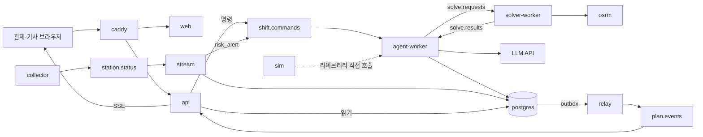
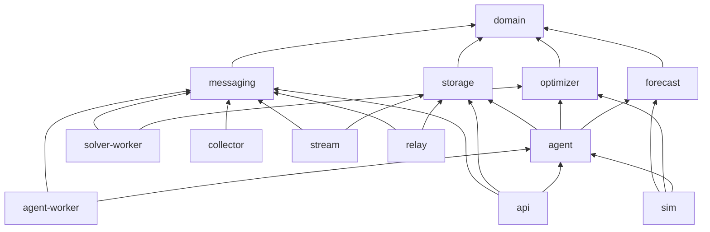
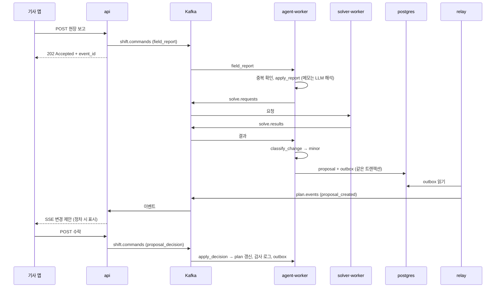
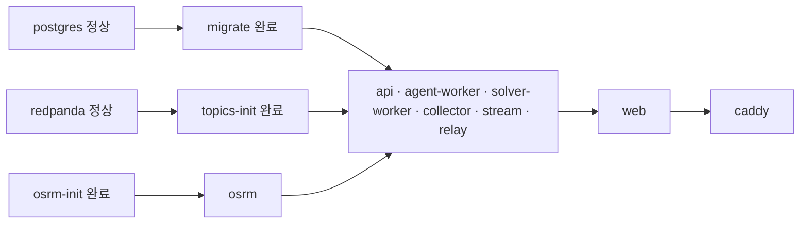

# 아키텍처: 공유자전거 재배치 에이전트

| 항목 | 내용 |
| --- | --- |
| 문서 상태 | 초안 v0.1 |
| 작성일 | 2026-10-20 |
| 관련 문서 | [PRD](PRD.md), [OR-Tools 파이프라인 가이드](or-tools/README.md) |
| 배포 전제 | 클라우드 없이 자체 서버에 **Docker Compose**로 운영 |

> 이 문서는 **무엇을 어떤 모듈로 나누고, 어떤 컨테이너를 띄우는지**를 정한다. 요구사항과 에이전트 그래프의 세부 흐름은 [PRD](PRD.md) 6절을 따른다. `[추정]` 표시는 측정하지 않은 값이다.

---

## 1. 요약

Python 라이브러리 모듈 6개 위에 실행 서비스 6개를 얹고, 서비스끼리는 Kafka(Redpanda)로 이벤트를 주고받는다. 상태의 원본은 Postgres 하나이며, 전체는 서버 한 대에서 `docker compose up`으로 뜬다.

### 설계 원칙

1. **숫자는 코드가, 해석은 LLM이, 결정은 사람이.** 재고·대수·경로는 `forecast`·`optimizer`가 계산하고, LLM은 구조화된 제약 조건과 설명 문장만 만든다.
2. **라이브러리와 실행기를 분리한다.** 계산 로직은 `packages/`에 두고, `services/`는 Kafka·HTTP와 연결만 한다. 서비스를 합치거나 나눠도 코드는 바뀌지 않는다.
3. **계획을 바꾸는 곳은 하나뿐이다.** `agent-worker`의 `apply_decision` 노드만 계획을 쓴다. `api`도 계획을 직접 수정하지 않고 명령을 보낸다 (UR-18).
4. **상태의 원본은 Postgres, Kafka는 운반.** "지금 계획이 무엇인가"는 항상 DB가 답한다.
5. **같은 입력이면 같은 결과.** 최적화기 탐색 한도는 시간이 아닌 고정 파라미터로 지정하고, 시간은 주입식 `Clock`으로 받는다 (NFR-04).

---

## 2. 기술 스택

| 계층 | 선택 | 이유 |
| --- | --- | --- |
| 백엔드 | Python 3.12, FastAPI, uv workspace | 최적화·ML·LLM 생태계가 모두 Python. 모노레포에서 모듈별 의존성 관리 |
| 에이전트 | LangGraph 1.x, LangChain | `interrupt` 기반 사람 승인, Postgres 체크포인트로 근무조 상태 유지 |
| 메시징 | Redpanda (Kafka 호환) | 근무조별 이벤트 순서 보장, 계산 작업 분리, 같은 이벤트를 여러 소비자에게 전달. 단일 바이너리라 Compose에 적합 |
| 최적화 | OR-Tools | 적재량 제약, 거점 포기(`AddDisjunction`), 출발 적재량 지정. 현재 `or-tools/rebalancing` 확장 |
| 예측 | 과거 평균 → LightGBM | 베이스라인 대비 개선을 수치로 제시 |
| 이동 시간 | OSRM (한국 OSM 추출본) | 자체 호스팅, 호출 제한 없음 |
| 운영 DB | PostgreSQL 16 + PostGIS | 계획·감사 로그·체크포인트·outbox·실시간 재고 |
| 대여이력 | Parquet + DuckDB | 3,736만 행 분석·재생. Postgres에 넣지 않음 |
| 웹 | Next.js, MapLibre 또는 카카오맵, deck.gl | `/control` 관제 화면, `/driver` 기사 PWA를 앱 하나로 |
| 실시간 전달 | SSE | 서버 → 화면 단방향이면 충분 |
| 리버스 프록시 | Caddy | HTTPS, 라우팅. SSE 응답을 버퍼링하지 않음 |
| LLM | `init_chat_model`로 공급사 설정 | 외부 API 또는 자체 호스팅(Ollama·vLLM) 중 선택. 코드 수정 없음 |
| 관측 (선택) | Prometheus, Grafana, Loki, Langfuse | `obs`·`llmobs` 프로필로 필요할 때만 기동 |
| 배포 | GitHub Actions → 이미지 레지스트리 → 서버에서 `docker compose pull && up -d` | 레지스트리는 GHCR 또는 자체 레지스트리 |

---

## 3. 시스템 구성



---

## 4. 모듈 구조

### 4.1 레포 구조

```text
skala_seoul_bike/
├─ pyproject.toml          uv workspace: packages/*, services/*, sim
├─ packages/               라이브러리 (Kafka·HTTP를 모름)
│  ├─ domain/              도메인 dataclass, 이벤트 Pydantic 스키마
│  ├─ forecast/            DemandPredictor 구현체
│  ├─ optimizer/           imbalance, planner(OR-Tools), baseline, travel_time
│  ├─ agent/               LangGraph 근무조 그래프, 노드, LLM 어댑터, Q&A
│  ├─ storage/             Postgres 리포지토리, Alembic, outbox, 중복 처리 기록
│  └─ messaging/           Kafka 생산·소비 래퍼, 직렬화
├─ services/               실행기 (라이브러리를 Kafka·HTTP에 연결)
│  ├─ api/                 FastAPI REST + SSE
│  ├─ agent-worker/
│  ├─ solver-worker/
│  ├─ collector/
│  ├─ stream/
│  └─ relay/
├─ sim/                    시뮬레이터 엔진, 정책 4종, 가상 관리자·기사, 지표
├─ apps/web/               Next.js
├─ analysis/               대여이력 역산 분석
├─ infra/                  compose.yaml, Caddyfile, topics.sh, Dockerfile
└─ docs/
```

**현재 코드 이전 (팀 합의 필요):** `or-tools/rebalancing/`은 `packages/optimizer/`로, `models.py`는 `packages/domain/`으로 옮긴다. 기존 `Imbalance` 경계 설계([01-architecture](or-tools/architecture/01-architecture.md))는 그대로 유지한다.

### 4.2 의존 방향



| 규칙 | 이유 |
| --- | --- |
| `packages/`는 `services/`를 import하지 않는다 | 라이브러리를 서비스 배치와 무관하게 재사용 |
| `agent`는 `messaging`을 모른다. 최적화 호출은 `SolveClient` 인터페이스로 주입 | agent-worker는 Kafka 구현, 시뮬레이터는 직접 호출 구현을 넣어 같은 그래프를 Kafka 없이 실행 |
| `optimizer`는 LangGraph를 모른다 | 최적화 담당이 에이전트와 독립적으로 개발·테스트 |
| 규칙은 `import-linter`로 CI에서 강제 | 리뷰에 의존하지 않음 |

### 4.3 라이브러리 모듈

| 모듈 | 공개 인터페이스 | 담당 |
| --- | --- | --- |
| `domain` | 도메인 dataclass, 이벤트 스키마 (`schema_version` 포함) | 전원 공동 |
| `forecast` | `DemandPredictor.predict(station, start, horizon_h) -> Forecast` | 예측 |
| `optimizer` | `compute_imbalances(...)`, `Planner.plan(imbalances, trucks, matrix, params) -> Plan` | 최적화 |
| `agent` | `build_shift_graph(deps)`, `build_qa_agent(deps)` | 에이전트 |
| `storage` | 리포지토리, `outbox.append()`, `processed.mark(event_id)` | 데이터 |
| `messaging` | `publish(topic, key, event)`, `consume(topic, group, handler)` | 데이터 |

### 4.4 실행 서비스

| 서비스 | 받는 것 | 보내는 것 | 쓰는 DB 스키마 |
| --- | --- | --- | --- |
| `api` | REST, `plan.events` | `shift.commands`, SSE | 없음 (읽기만) |
| `agent-worker` | `shift.commands`, `solve.results` | `solve.requests` | `ops`, `audit`, `lg` |
| `solver-worker` | `solve.requests` | `solve.results` | 없음 |
| `collector` | 서울 열린데이터 API | `station.status` | 없음 |
| `stream` | `station.status` | `shift.commands`(`risk_alert`) | `telemetry` |
| `relay` | `ops.outbox` | `plan.events` | `ops.outbox` 발행 표시만 |

---

## 5. 모듈 계약

### 5.1 현재 `models.py`에서 바꿀 점

| 대상 | 변경 | 이유 |
| --- | --- | --- |
| `DemandPredictor.predict(station, hour)` | `predict(station, start: datetime, horizon_h: int)` | 날짜·요일·날씨와 3시간 예측 구간 표현 |
| `Station` | `district`, `elevation_m`, `role`(고정 회수·고정 배치·변동) 추가 | 역산 분석의 역할·고도 반영 (PRD 1.5) |
| `Imbalance` | `priority`, `kind`(빈 위험·과적재), `reasons` 추가 | 벌점과 포기 사유 근거 (FR-03, FR-05) |
| `Truck` | `position`, `load`, `shift_end` 추가 | 현재 위치·적재량에서 재경로 |
| `Stop` | `eta`, `reason` 추가 | 기사 화면, 근거 표시 |
| `Plan` | `version` 추가, `unserved`에 사유 포함 | 승인 흐름, 포기 거점 표시 |
| 트럭 용량 기본값 | 20대 → 15대 | 역산 추정 (PRD 1.5) |
| 대여소 상한 | 거치대 수 하드 제약 → 설정값 | 과적재 정의 변경 (PRD 7.1) |

도메인 모델은 기존대로 `dataclass`를 쓰고, Pydantic은 API·이벤트·LLM 출력 경계에서만 쓴다.

### 5.2 주입 인터페이스

```python
class Clock(Protocol):
    def now(self) -> datetime: ...              # 실제 시각 또는 시뮬레이터 가상 시각

class TravelTime(Protocol):
    def matrix(self, points: list[LatLon], depart_at: datetime) -> list[list[int]]: ...  # 초

class SolveClient(Protocol):
    def solve(self, request: SolveRequest) -> Plan: ...  # Kafka 요청·응답 또는 직접 호출

class StationSource(Protocol):
    def snapshot(self, region_id: str, at: datetime) -> list[Station]: ...
```

LangGraph 그래프는 이 의존성을 runtime context로 받는다. 노드 안에서 `datetime.now()`를 직접 부르지 않는다.

### 5.3 `domain` 변경 규칙

- 필드는 **추가만** 하고 삭제·이름 변경은 하지 않는다. 소비자는 모르는 필드를 무시한다.
- 이벤트에는 `event_id`, `schema_version`, `occurred_at`, `shift_id`(해당 시)를 항상 넣는다.
- 웹용 TypeScript 타입은 FastAPI OpenAPI와 이벤트 JSON Schema에서 생성한다 (`openapi-typescript`). 손으로 쓰지 않는다.

---

## 6. 메시징

### 6.1 토픽

| 토픽 | 키 | 파티션 | 보내는 쪽 | 받는 쪽 | 내용 |
| --- | --- | --- | --- | --- | --- |
| `station.status` | `station_id` | 6 | collector | stream | 5~10분 간격 실시간 재고 |
| `shift.commands` | `shift_id` | 12 | api, stream, sim | agent-worker | 현장 보고, 승인·수락, 관리자 요청, 위험 알림, 근무 종료 |
| `solve.requests` | `shift_id` | 12 | agent-worker | solver-worker | 최적화 요청 |
| `solve.results` | `shift_id` | 12 | solver-worker | agent-worker | 최적화 결과 |
| `plan.events` | `shift_id` | 6 | relay | api (SSE) | 계획 활성화, 변경안 생성, 변경 적용 |

파티션 수는 `[추정]` 초기값이다. **워커를 늘릴 수 있는 상한이 파티션 수**이고, 나중에 늘리면 키가 배정되는 파티션이 바뀌므로 처음부터 넉넉히 잡는다.

### 6.2 신뢰성 규칙

| 규칙 | 내용 |
| --- | --- |
| 중복 처리 방지 | 모든 이벤트에 `event_id`. 소비자는 `ops.processed_events`에 기록하고 이미 처리한 이벤트는 버린다 |
| outbox | 계획 변경과 발행할 이벤트를 **같은 트랜잭션**으로 `ops.outbox`에 기록. relay가 `FOR UPDATE SKIP LOCKED`로 읽어 발행 |
| 최적화 요청 ID | `{shift_id}:{plan_version}:{seq}`. 노드가 interrupt 후 재실행돼도 같은 ID로 요청해 결과가 하나만 생김 |
| 최적화 대기 | 요청 ID로 응답을 짝지어 `60초(초기값)` 대기. 넘으면 탐욕 휴리스틱으로 임시안을 만들고 화면에 "임시안" 표시 |
| 비동기 명령 | api는 명령을 받으면 `202 Accepted`와 `event_id`만 반환. 결과는 SSE로 도착. 기사 앱은 "처리 중" 상태를 표시 |
| 순서 | 한 근무조의 모든 입력은 `shift.commands`의 같은 파티션에 들어가 순서대로 처리 |

### 6.3 Kafka에 넣지 않는 것

- **LLM 호출**: agent-worker 안에서 동기로 처리한다.
- **계획 상태 조회**: Postgres에서 읽는다. 이벤트 재생으로 상태를 만들지 않는다.
- **대량 시뮬레이션**: `sim`이 라이브러리를 직접 호출한다. 데모 때만 `shift.commands`로 보내 실제 경로를 보여준다.

---

## 7. 데이터 저장

### 7.1 Postgres 스키마와 소유권

스키마마다 **쓰는 모듈을 하나로** 정한다. 다른 모듈은 읽기만 한다.

| 스키마 | 쓰는 모듈 | 주요 테이블 |
| --- | --- | --- |
| `ref` | 적재 스크립트 | `stations`(위치, 거치대 수, 고도, 역할), `trucks`, `regions` |
| `ops` | agent-worker | `shifts`, `plans`, `plan_stops`, `unserved`, `constraints`, `proposals`, `field_reports`, `outbox`, `processed_events` |
| `audit` | agent-worker | `audit_events` (append-only, UPDATE·DELETE 권한 없음) |
| `lg` | agent-worker | LangGraph `PostgresSaver` 체크포인트 |
| `telemetry` | stream | `station_status`(시계열), `forecasts` |
| `sim` | sim | `runs`, `metrics` |

### 7.2 파일 저장

| 데이터 | 형식 | 위치 |
| --- | --- | --- |
| 대여이력 2025 | Parquet | `data/trips/` 볼륨 (읽기 전용 마운트) |
| 역산 재배치 기록 | Parquet | `data/rebalancing/` (현행 운영 재현 정책 입력) |
| OSRM 전처리 결과 | OSRM 파일 | `osrm` 볼륨 |
| 학습된 예측 모델 | 파일 + 버전 | `models/` 볼륨 |

---

## 8. 핵심 흐름

### 8.1 현장 보고에서 변경 수락까지



### 8.2 계획 초안 생성

근무조 시작 30분 전(PRD 7.4: 06:30, 12:30, 18:30) 스케줄러가 `shift.commands`에 `shift_start`를 보낸다. agent-worker가 `ingest → compute_targets → optimize → explain`을 실행하고 `manager_review` interrupt에서 멈춘다. 관리자의 승인은 다시 `shift.commands`로 들어온다.

---

## 9. 컨테이너 구성

### 9.1 기본 (`docker compose up`)

| 서비스 | 이미지 | 개수 | 외부 포트 | 볼륨 | 역할 |
| --- | --- | --- | --- | --- | --- |
| `caddy` | `caddy:2` | 1 | 80, 443 | `caddy_data` | HTTPS, `/` → web, `/api` → api |
| `web` | 빌드 (`apps/web`) | 1 | 없음 | 없음 | Next.js |
| `api` | 빌드 (`services/api`) | 1~2 | 없음 | 없음 | REST + SSE |
| `agent-worker` | 빌드 | 1~3 | 없음 | 없음 | LangGraph |
| `solver-worker` | 빌드 | 1~4 | 없음 | 없음 | OR-Tools |
| `collector` | 빌드 | **1** | 없음 | 없음 | 실시간 재고 수집 |
| `stream` | 빌드 | 1 | 없음 | 없음 | 재고 적재, 위험 감지 |
| `relay` | 빌드 | 1 | 없음 | 없음 | outbox 발행 |
| `redpanda` | `redpandadata/redpanda` | 1 | 없음 | `rpdata` | 메시지 브로커 |
| `postgres` | `postgis/postgis:16-3.4` | 1 | 없음 | `pgdata` | 운영 DB |
| `osrm` | `ghcr.io/project-osrm/osrm-backend` | 1 | 없음 | `osrm` (읽기) | 이동 시간 |

### 9.2 1회 실행 (기동 시 자동)

| 서비스 | 하는 일 | 완료 조건 |
| --- | --- | --- |
| `migrate` | `alembic upgrade head` | 앱 서비스 시작 전 성공 |
| `topics-init` | 6.1의 토픽과 파티션 생성 (이미 있으면 건너뜀) | 앱 서비스 시작 전 성공 |
| `osrm-init` | 한국 OSM 추출본 전처리 (결과가 있으면 건너뜀) | `osrm` 시작 전 성공 |

### 9.3 선택 프로필

| 프로필 | 서비스 | 용도 |
| --- | --- | --- |
| `tools` | `redpanda-console` (127.0.0.1에만 바인딩) | 토픽·메시지 확인 |
| `obs` | Prometheus, Grafana, Loki | 지표·로그 |
| `llmobs` | Langfuse 자체 호스팅 | LLM 호출 추적. 추가 저장소 컨테이너가 여러 개 필요하므로 필요할 때만 |
| `sim` | `sim` | 시뮬레이션 일괄 실행 |

### 9.4 기동 순서



`depends_on`의 `condition: service_healthy`와 `service_completed_successfully`로 보장한다.

### 9.5 서버 사양

**8 vCPU, 32GB 메모리, SSD 200GB**에서 시작한다 `[추정]`. 메모리는 OSRM, Postgres, solver-worker가 대부분 쓴다. 측정 후 조정한다.

---

## 10. 운영

| 항목 | 방법 |
| --- | --- |
| 배포 | CI가 서비스별 이미지를 빌드해 레지스트리에 올림 (`uv sync --package <서비스>`로 필요한 의존성만). 서버에서 `docker compose pull && docker compose up -d` |
| 확장 | `docker compose up -d --scale solver-worker=3`. 자동 확장 없음 |
| 백업 | `pg_dump`를 cron으로 매일 실행해 **다른 디스크와 다른 장비**에 보관. 복구 절차를 한 번 실제로 해본다 |
| 로그 | `json-file` 드라이버에 `max-size`·`max-file` 설정. `docker compose logs -f <서비스>` |
| 비밀값 | `.env` 파일 (권한 600, 저장소에 커밋 금지). 열린데이터 API 키, LLM API 키, DB 비밀번호 |
| HTTPS | 공인 도메인이 있으면 Caddy 자동 인증서. 내부망이면 Caddy 내부 CA 또는 사내 인증서 |

---

## 11. 함정 체크리스트

| 함정 | 대응 |
| --- | --- |
| `--scale` 대상에 `container_name`·호스트 포트가 있으면 두 번째 컨테이너가 안 뜸 | 외부 포트는 `caddy`만 연다. 내부는 서비스 이름으로 통신 |
| 프록시가 SSE를 버퍼링하거나 유휴 연결을 끊음 | Caddy 사용. 서버에서 15~30초마다 heartbeat(`: ping`) 전송 |
| OR-Tools가 FastAPI 이벤트 루프를 막음 | 최적화는 solver-worker에서만 실행. api에서 직접 부르지 않음 |
| OR-Tools 계산 중 poll이 멈춰 소비자 그룹에서 쫓겨남 | `max.poll.interval.ms`를 계산 제한보다 크게. 또는 계산 중 파티션 `pause()` 후 poll 유지 |
| Compose 기본 종료 대기 10초 | agent-worker·solver-worker는 `stop_grace_period` 연장, SIGTERM에 소비자 정상 종료 |
| interrupt 재개 시 노드가 처음부터 다시 실행 | interrupt 노드에 부작용을 두지 않음. 외부 호출은 요청 ID로 멱등하게 |
| Redpanda 1대라 복제 없음 | 업무 상태의 원본은 Postgres. Postgres 백업을 우선 |
| collector가 2개 뜨면 같은 재고를 두 번 수집 | 1개로 고정. 늘려야 하면 Postgres advisory lock으로 리더 하나만 수집 |
| 로그가 디스크를 채움 | 로그 드라이버 크기 제한 |

---

## 12. 확장 경로

Compose 구성에서 시작해 필요할 때 단계적으로 옮긴다. **모듈 구조와 토픽 설계는 바뀌지 않고, 실행 환경과 인스턴스 수만 바뀐다.**

| 단계 | 바뀌는 것 |
| --- | --- |
| 서버 1대 (현재) | Docker Compose, Redpanda 1대 |
| 서버 여러 대 | 역할별 서버 분리(엣지·워커·데이터), Kafka 3대 복제(`acks=all`, `min.insync.replicas=2`), Postgres 읽기 복제본. 읽기 지연은 `plan.version`으로 처리 |
| 운영 규모 | 오케스트레이터 도입, 소비 지연 기반 자동 확장, 텔레메트리와 제어 이벤트의 Kafka 클러스터 분리 |
| 전국 규모 | 권역 묶음 단위의 셀 구조, 권역 간 이동(LP)과 권역 내 경로(VRP)의 2단계 최적화, 멀티테넌시 |

---

## 13. 열린 결정

| 항목 | 선택지 | 결정 필요 시점 |
| --- | --- | --- |
| `or-tools/` 코드 이전 | `packages/optimizer`로 이동 / 현 위치 유지 | 모듈 구조 착수 전 |
| Kafka 도입 시점 | M4(이벤트 루프) 전 / 후 | M4 착수 전. 이후에 넣으면 이벤트 진입 경로를 다시 짜야 함 |
| LLM 공급사 | 외부 API / Ollama·vLLM 자체 호스팅 | M5 전. 자체 호스팅이면 GPU 서버 필요 |
| 지도 | MapLibre(키 불필요) / 카카오맵(키 필요) | 웹 착수 전 |
| 데모 권역 | 광진·성동 후보 (역산 상위 회수·배치 대여소 다수 포함) | M1 |
| 인증 | 데모용 역할 토큰 / Keycloak 자체 호스팅 | M4 |
