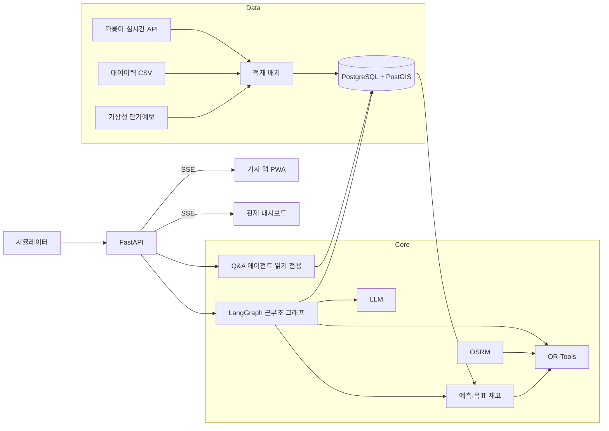
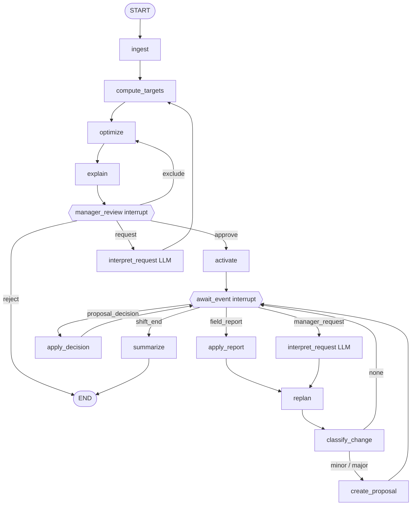

# PRD: 공유자전거 재배치 에이전트

| 항목 | 내용 |
| --- | --- |
| 문서 상태 | 초안 v0.2 |
| 작성일 | 2026-10-19 (v0.2 갱신 2026-10-20) |
| 기반 문서 | 「공유자전거 재배치 에이전트 기획 의도와 사용자 요구사항」(2026-10-19, @민규), 「따릉이 재배치 역산 정리」(2026-10-20) |
| 저장소 | `skala_seoul_bike` (스칼라 AI 캡스톤) |

> 사용자 요구와 기대 효과는 공개 기사와 연구에 기반한 **가설**이다. 수치 목표는 시뮬레이터로 측정해 확정하며, 본문에서 `초기값`으로 표시한 숫자는 인터뷰 후 조정한다.

---

## 1. 개요

### 1.1 문제

재배치 **필요량**은 데이터로 계산되지만, 그 필요량을 **트럭별 경로·순서·대수**로 바꾸는 일과 실행 중 **현장 변화에 맞춘 재조정**은 사람의 경험에 의존한다.

| 구조적 한계 | 설명 |
| --- | --- |
| 계획과 실행의 단절 | 필요수량을 트럭 경로로 바꾸는 일이 수작업 |
| 현장 정보가 돌아오지 않음 | 시스템 재고와 현장 재고의 차이, 진입 불가 등이 계획에 반영되지 않음 |
| 판단 근거가 남지 않음 | 왜 이 거점을 먼저 갔는지 기록되지 않아 검토·인수인계가 어려움 |

### 1.2 제품 정의

Agent가 재배치 계획을 트럭 경로까지 세우고, 기사의 현장 보고로 남은 경로를 다시 짜며, **최종 결정은 사람이 내리는** 재배치 운영 도구.

### 1.3 목표

1. 필요량에서 실행 가능한 트럭 경로 초안까지 자동화한다.
2. 기사의 현장 보고를 남은 경로에 바로 반영한다.
3. 모든 계획과 변경에 이유와 근거를 남긴다.
4. 도입 효과를 시뮬레이터로 수치화한다.

### 1.4 비목표

- 고장 판정·정비
- 이용자 인센티브
- 배터리 교체 운영
- 실제 운영 기관 시스템과의 연동 (시연은 따릉이 공개데이터 기반)

### 1.5 현행 재배치 운영 (2025 대여이력 역산 추정)

> 출처: 「따릉이 재배치 역산 정리」(2026-10-20). 공개데이터에는 재배치 기록이 없어 모든 값은 대여이력에서 **추정**한 값이며, 실제 재고·운영과 대조하지 않았다.

| 항목 | 추정값 | 설계 반영 |
| --- | --- | --- |
| 하루 재배치량 | 성수기(4~10월) 약 4,100~4,900대, 12~2월 약 1,700~1,900대. 추정 방식상 하한에 가까울 수 있음 | 시뮬레이터 규모, 현행 운영 재현 |
| 트럭 용량 | 약 15대 (방문 묶음이 13~15대에 몰리고 15대 초과 시 급감) | 7.2 적재량 상한 초기값 |
| 근무 시간대 | 07–10시, 13–16시, 19–20시. 밤(22~06시) 확실한 방문 약 2% | 7.4 근무조 |
| 방문 직전 재고 | 배치: 중앙값 2대, 30%가 0대. 회수: 중앙값 31대 (거치대 중앙값 10개) | 7.1 목표 재고, 9.2 지표 |
| 대여소 역할 | 회수 533곳·배치 531곳 (각 19%). 하루 불균형 10대 이상 182곳은 87%의 날 같은 방향, 3대 미만 1,248곳은 51% | 7.1 역할 사전 정보, 7.3 예측 집중 대상 |
| 고도 | 자치구 중앙값보다 30m 이상 높은 대여소의 배치 대여소 비율 57%. 재배치는 자전거를 평균 14.4m 위로 옮김 | 7.3 예측 피처, 설명 문장 |
| 공급처 분산 | 상위 배치 대여소에서 가장 많이 가져온 한 곳의 비중 9~35% | 고정 짝짓기 대신 VRP를 쓰는 근거 |
| 행사 | 2025 불꽃축제 당일 4개 구 회수 1,424대 (다른 토요일 평균 769대의 약 1.9배). 해당 구역 대여·반납 일시 중지 | 6.4 `station_suspended` 제약, 9.1 시나리오 |

**설계 영향:** 회수 직전 재고가 거치대의 약 3배라면 만차는 반납을 막는 상태가 아니다. 따라서 거치대 수를 재고의 하드 상한으로 쓰지 않고, 빈 대여소와 과적재를 별도 지표로 다룬다 (7.1, 9.2). 이 가정은 실시간 API 수집으로 검증한다 (M1).

---

## 2. 사용자

| 사용자 | 역할 | 이 제품에서 하는 일 | 사용 화면 |
| --- | --- | --- | --- |
| 관제 관리자 | 권역 재배치 총괄 | 계획 검토·승인, 큰 변경 승인, 상황 반영 요청, 질의 | 관제 대시보드 (웹) |
| 트럭 기사 | 회수·배치 실행 | 작업 목록 확인, 수량·현장 사정 보고, 경로 변경 수락 | 기사 앱 (모바일 웹 PWA) |
| 운영사 책임자 | 도입·예산 결정 | 도입 전후 성과 비교 | 성과 리포트 (웹) |

자전거 이용자는 시스템을 직접 쓰지 않는 최종 수혜자다.

### 2.1 핵심 시나리오

**S1. 근무조 시작 전 계획 승인**
1. 근무조 시작 `30분 전(초기값)` 시스템이 계획 초안을 생성한다. 근무조는 07시·13시·19시에 시작하는 세 개로 가정한다 (1.5).
2. 관리자는 지도에서 위험 거점, 트럭별 경로, 포기 거점과 이유를 확인한다.
3. "여의도 불꽃축제로 대여·반납 일시 중지"를 입력하면 Agent가 제약 조건으로 바꿔 계획을 다시 만든다.
4. 관리자가 일부 거점을 빼고 승인한다. 재계산된 안을 확인한 뒤 최종 승인한다.

**S2. 실행 중 현장 보고와 재경로**
1. 기사가 정류장에서 실제 재고를 보고한다 (앱 8대, 실제 3대).
2. 시스템이 남은 경로를 다시 계산한다.
3. 변경이 작으면 기사에게 제안이 가고, 정차 중에 수락·거절한다.
4. 변경이 크면 (트럭 간 배정 이동 등) 관리자 승인 후 기사에게 간다.

**S3. 도입 효과 확인**
1. 운영사 책임자가 과거 특정 날짜를 선택한다.
2. 재배치 없음 / 단순 규칙 / 현행 운영 재현 / 본 시스템 네 정책의 빈 대여소 시간과 과적재 시간을 비교한다.

---

## 3. 기능 요구사항

우선순위: **P0** 필수, **P1** 권장, **P2** 선택. 각 FR은 기획서의 UR과 1:1로 대응한다.

### 3.1 관제 관리자

| ID | 요구 | 수용 기준 | UR | 우선 |
| --- | --- | --- | --- | --- |
| FR-01 | 위험 거점 대시보드 | 권역 지도 한 화면에 대여소별 현재 재고, `3시간(초기값)` 후 예측 재고, 빈 대여소 위험과 과적재 등급, 대여소 역할(고정 회수·고정 배치·변동)을 표시 | UR-01 | P0 |
| FR-02 | 계획 초안 생성 | 트럭별 정류장 순서, 정류장별 회수·배치 대수, 도착 예정 시각을 포함한 초안을 근무조 시작 전 자동 생성 | UR-02 | P0 |
| FR-03 | 거점별 근거 | 계획의 각 정류장에 현재 재고, 예측 재고, 예상 빈 시각 또는 과적재 정도, 대여소 역할, 고도, 우선순위 점수, 적용된 제약 조건을 표시 | UR-03 | P0 |
| FR-04 | 승인·거절·일부 제외 | 승인, 거절, 거점 제외 후 승인 세 동작 제공. 제외 시 재계산된 안을 다시 검토 화면으로 보여주며, 관리자 확인 없이 활성화하지 않음 | UR-04 | P0 |
| FR-05 | 포기 거점과 이유 | 자원 부족으로 빠진 거점 목록과 각 거점의 우선순위 점수, 제외 사유(적재량·시간 한계)를 표시 | UR-05 | P0 |
| FR-06 | 실시간 진행 모니터링 | 트럭 위치, 완료 정류장, 대기 중인 변경안을 `5초(초기값)` 이내 지연으로 반영 | UR-06 | P0 |
| FR-07 | 변경 등급 정책 | 변경안을 코드 규칙으로 작은 변경(기사 수락)과 큰 변경(관리자 승인)으로 분류. 기준은 설정으로 조정 가능 | UR-07 | P1 |
| FR-08 | 자연어 질의 | "오늘 이 구역 회수가 왜 많지?"에 계획 데이터와 감사 로그를 근거로 답변. 답변에 참조한 데이터 출처 표시 | UR-08 | P1 |
| FR-09 | 상황 반영 요청 | 행사·공사·날씨를 자연어로 입력하면 구조화된 제약 조건으로 변환해 관리자에게 확인받은 뒤 재계산 | UR-09 | P1 |

### 3.2 트럭 기사

| ID | 요구 | 수용 기준 | UR | 우선 |
| --- | --- | --- | --- | --- |
| FR-10 | 작업 목록 | 오늘 갈 정류장 순서와 정류장별 싣기·내리기 대수를 한 화면에 표시 | UR-10 | P0 |
| FR-11 | 수량 보고 | 정류장에서 실제 수량 보고를 `3번(초기값)` 이하의 터치로 완료 (기본값 = 계획 수량, +/- 조정) | UR-11 | P0 |
| FR-12 | 현장 사정 보고 | 진입 불가·공사 등을 선택지 또는 짧은 메모로 남기면 남은 경로를 재계산 | UR-12 | P0 |
| FR-13 | 변경 수락 | 변경 전후 비교를 보여주고 기사가 수락·거절. 거절 시 기존 경로 유지 | UR-13 | P0 |
| FR-14 | 운전 중 확인 강요 금지 | 운행 중에는 모달·소리 알림 없이 배지만 표시. 정차 또는 정류장 도착 시에만 변경안 표시 | UR-14 | P0 |
| FR-15 | 고장 자전거 동시 회수 | 경로상 신고된 고장 자전거를 회수 정류장에 포함 (적재량 계산에 반영) | UR-15 | P2 |

### 3.3 운영사 책임자

| ID | 요구 | 수용 기준 | UR | 우선 |
| --- | --- | --- | --- | --- |
| FR-16 | 성과 비교 | 같은 날짜·같은 트럭 수에서 네 정책(9.1)의 빈 대여소-분, 과적재 대여소-분, 해소 대수를 비교 | UR-16 | P0 |
| FR-17 | 운영 방식 설정 | 계획 단위를 대여소 또는 구역(H3 격자)으로 선택 가능 | UR-17 | P1 |
| FR-18 | 승인 보장 | 계획 활성화와 경로·배정 변경은 사람의 승인 이벤트 없이는 일어나지 않음. 감사 로그로 증명 가능 | UR-18 | P0 |

---

## 4. 비기능 요구사항

| ID | 항목 | 기준 |
| --- | --- | --- |
| NFR-01 | 재경로 응답 시간 | 대여소 200곳, 트럭 5대 기준 현장 보고부터 변경안 생성까지 `10초(초기값)` 이내 |
| NFR-02 | 계획 생성 시간 | 같은 규모에서 초안 생성 `60초(초기값)` 이내 |
| NFR-03 | LLM 장애 내성 | LLM이 실패해도 계획 생성·승인·보고·재경로의 핵심 흐름은 동작. 설명은 템플릿 문장으로 대체 |
| NFR-04 | 재현성 | 같은 입력과 같은 설정이면 같은 계획. 최적화기 탐색 한도는 시간이 아닌 고정 파라미터로 지정 |
| NFR-05 | 감사 가능성 | 계획 버전, 근거, 제안, 승인·거절, 현장 보고를 append-only로 저장. 근무조 단위로 조회 가능 |
| NFR-06 | 권한 | 기사는 자기 트럭의 경로와 제안만 조회·응답. 계획 승인은 관리자만 |
| NFR-07 | 숫자 출처 | 재고, 대수, 경로, 우선순위 등 모든 숫자는 코드가 계산. LLM 출력의 숫자는 검증 후에만 제약 조건으로 사용 |

---

## 5. 시스템 설계

### 5.1 역할 분담

| 주체 | 맡는 것 | 구현 |
| --- | --- | --- |
| 계산 (코드) | 수요 예측, 목표 재고, 우선순위, 경로 최적화, 변경 분류 | LightGBM, OR-Tools, 규칙 |
| Agent (LLM) | 상황 요청 해석, 현장 메모 해석, 계획 설명, 질의응답 | LangGraph 노드, LangChain agent |
| 사람 | 계획 승인 (관리자), 경로 변경 수락 (기사) | LangGraph `interrupt` + 이벤트 |

### 5.2 기술 스택

| 계층 | 선택 | 이유 |
| --- | --- | --- |
| 언어·백엔드 | Python 3.12, FastAPI | 최적화·ML·LLM 생태계가 모두 Python |
| 에이전트 | LangGraph, LangChain | 상태 그래프, `interrupt` 기반 사람 승인, 체크포인트 |
| 최적화 | Google OR-Tools (VRP) | 적재량 제약, 거점 포기(`AddDisjunction`), 출발 적재량 지정 지원 |
| 예측 | 과거 평균 베이스라인 → LightGBM | 베이스라인 대비 개선을 수치로 제시 |
| 이동 시간 | OSRM (한국 OSM 데이터, 자체 호스팅) | 호출 제한 없이 시뮬레이터 반복 실행. 실시간 교통은 추후 카카오모빌리티 |
| DB | PostgreSQL + PostGIS | 공간 질의, 감사 로그, LangGraph 체크포인트 공용 |
| 체크포인터 | `InMemorySaver` (개발), `PostgresSaver` (운영) | 근무조 스레드 상태 영속화 |
| 실시간 전달 | SSE (또는 WebSocket) | 관제 화면·기사 앱 상태 갱신 |
| 프론트엔드 | Next.js, 카카오맵 또는 MapLibre, deck.gl | 지도·히트맵 |
| 기사 앱 | 모바일 웹 PWA | 설치 부담 없음, 큰 버튼 UI |

### 5.3 구성도



---

## 6. 에이전트 설계 (LangGraph)

### 6.1 원칙

1. **근무조 하나 = 그래프 스레드 하나.** `thread_id = {권역}:{날짜}:{근무조}`.
2. **숫자는 코드 노드만 만든다.** LLM 노드는 구조화된 제약 조건과 설명 문장만 출력한다.
3. **계획을 바꾸는 노드는 `apply_decision` 하나뿐.** Agent는 변경안(proposal)만 만든다.
4. **실행 중 사람 입력은 단일 `await_event` interrupt로 받는다.** 기사별로 그래프를 멈추지 않는다.

### 6.2 그래프



### 6.3 노드 명세

| 노드 | 종류 | 입력 | 출력 |
| --- | --- | --- | --- |
| `ingest` | 코드 | 권역, 시각 | `snapshot` (재고, 예측 순유출입, 거치대 수) |
| `compute_targets` | 코드 | `snapshot`, `constraints` | `targets` (목표 재고 범위, 필요 대수, 우선순위 점수, 근거) |
| `optimize` | 코드 | `targets`, `trucks`, 이동 시간 행렬 | `plan` (트럭별 정류장, 포기 거점과 사유), `version` 증가 |
| `explain` | LLM | `plan`, 근거 데이터 | `plan.explanation` (실패 시 템플릿 문장) |
| `manager_review` | interrupt | `plan` | `approve` / `exclude(ids)` / `request(text)` / `reject` |
| `interpret_request` | LLM | 자연어 요청 | `Constraint[]` (스키마 검증 후 반영, 관리자 확인 필요) |
| `activate` | 코드 | 승인된 `plan` | `status = active`, 감사 로그 |
| `await_event` | interrupt | 없음 | 이벤트 1건 |
| `apply_report` | 코드 + LLM | 현장 보고 | 재고·트럭 상태 갱신. 자유 메모는 LLM이 `{type, station_id}`로 변환 |
| `replan` | 코드 | 현재 트럭 위치·적재량, 남은 정류장 | 후보 경로 |
| `classify_change` | 코드 | 기존 경로, 후보 경로 | `none` / `minor` / `major` |
| `create_proposal` | 코드 | 후보 경로, 등급 | `proposals`에 추가. 같은 트럭의 이전 대기안은 `superseded` |
| `apply_decision` | 코드 | 승인·수락 이벤트 | `plan` 갱신 또는 기존 유지, 감사 로그 |
| `summarize` | 코드 + LLM | 근무조 기록 | 근무조 요약, 인수인계 메모 |

### 6.4 State

```python
class ShiftState(TypedDict):
    region_id: str
    shift_id: str
    snapshot: Snapshot                  # 재고, 예측, 거치대 수
    constraints: list[Constraint]       # 관리자 요청, 현장 사정
    targets: dict[str, Target]          # 대여소별 목표와 근거
    plan: Plan                          # 트럭별 경로, 포기 거점, version
    status: Literal["draft", "proposed", "active", "rejected", "closed"]
    trucks: dict[str, TruckState]       # 현재 위치, 적재량, 완료 정류장
    proposals: list[Proposal]           # 대기·처리된 변경안
    audit: Annotated[list[AuditEvent], operator.add]
```

```python
class Proposal(BaseModel):
    id: str
    truck_ids: list[str]
    before: list[Stop]
    after: list[Stop]
    grade: Literal["minor", "major"]
    approver: Literal["driver", "manager"]
    status: Literal["pending", "accepted", "rejected", "superseded"]
    reason: str
```

`Constraint`는 LLM이 해석한 관리자 요청과 기사의 현장 보고가 공통으로 쓰는 형식이다. `station_suspended`는 2025 불꽃축제처럼 운영 기관이 대여·반납을 중지한 경우다. 중지 시간 동안 해당 대여소의 수요를 0으로 보고 배치 대상에서 제외하며, 사전 회수 여부는 관리자가 정한다.

```python
class Constraint(BaseModel):
    type: Literal[
        "target_adjust",       # 목표 재고 가감 (행사·날씨)
        "station_suspended",   # 대여·반납 일시 중지
        "station_blocked",     # 트럭 진입 불가 (현장 보고)
        "inventory_override",  # 현장 실제 재고로 보정
        "priority_boost",      # 관리자 지정 우선
    ]
    station_ids: list[str]
    value: int | None = None
    valid_from: datetime
    valid_to: datetime
    source: Literal["manager", "driver", "system"]
    reason: str
```

### 6.5 이벤트 (`Command(resume=...)` 페이로드)

| type | 보내는 주체 | 필드 |
| --- | --- | --- |
| `field_report` | 기사 | `truck_id, station_id, actual_bikes, loaded, unloaded, issue?, memo?` |
| `proposal_decision` | 기사 / 관리자 | `proposal_id, accept, by` |
| `manager_request` | 관리자 | `text` |
| `shift_end` | 관리자 / 스케줄러 | 없음 |

### 6.6 변경 등급 규칙 (`초기값`, 설정으로 조정)

| 등급 | 조건 | 승인 주체 |
| --- | --- | --- |
| none | 정류장 순서·대수 변화 없음 | 없음 |
| minor | 같은 트럭 안의 변경, 빠지는 정류장 2곳 이하, 소요 시간 증가 10분 이하 | 기사 |
| major | 트럭 간 배정 이동, 트럭 추가 투입, 위 기준 초과, 관리자 요청에서 비롯된 변경 | 관리자 → 기사 |

### 6.7 Q&A 에이전트 (FR-08)

- `langchain.agents.create_agent`로 근무조 그래프와 **분리**한다.
- 도구는 읽기 전용만 제공한다: `get_plan`, `get_station`, `get_targets`, `get_audit`.
- 쓰기 도구가 없으므로 질의응답 중 계획이 바뀔 수 없다.

### 6.8 구현 주의사항

1. **interrupt 재개 시 노드가 처음부터 다시 실행된다.** interrupt 노드에는 부작용(DB 쓰기, LLM 호출)을 두지 않는다.
2. **체크포인트는 감사 로그가 아니다.** 업무 기록은 별도 append-only 테이블에 쓴다.
3. **LLM 출력은 Pydantic 스키마로 받고 범위를 검증한다.** 예: 목표 재고 변경 폭이 운영 상한(7.1)을 넘거나 대여소 ID가 권역에 없으면 거부.
4. **LLM은 주입식으로 구성한다.** 테스트에서 고정 응답 객체로 교체할 수 있어야 한다.

---

## 7. 계산 모듈

### 7.1 목표 재고와 우선순위

1. 대여소별 `H시간(초기값 3)` 순유출입 예측으로 예상 재고 궤적을 계산한다.
2. 궤적이 `[하한, 운영 상한]`을 벗어나지 않는 목표 재고 범위를 정한다. **운영 상한은 하드 제약이 아닌 설정값**이다. 초기값은 거치대 수이며, 역산 결과(회수 직전 재고 중앙값 31대, 거치대 중앙값 10개)가 실시간 API로 검증되면 조정한다.
3. 필요 대수 = 목표 범위까지의 차이 (회수 또는 배치).
4. 우선순위 점수 = 부족 대수 × 수요 강도 × 임박도 × 유형 가중치. **빈 대여소 위험의 가중치를 과적재보다 높게** 둔다. 대여를 못 하는 불편이 반납 혼잡보다 직접적이기 때문이다. 점수와 구성 요소를 근거로 저장한다.
5. 대여소 역할을 사전 정보로 쓴다. 하루 평균 불균형이 `10대 이상(초기값)`이고 방향이 일정한 대여소는 고정 회수·고정 배치로 표시하고, 예측이 비어 있거나 불확실할 때 역할 방향을 기본값으로 쓴다.

### 7.2 경로 최적화 (OR-Tools)

| 요소 | 모델링 |
| --- | --- |
| 적재량 | 회수 +q, 배치 -q의 용량 차원. 범위 `[0, 트럭 용량]`, 트럭 용량 초기값 15대 (1.5 역산 추정), 출발값 = 현재 적재량 |
| 시간 | 이동 시간 + 정차 시간(`3분 + 대당 0.5분`, 초기값). 근무조 종료 시각을 상한으로 설정 |
| 거점 포기 | `AddDisjunction(벌점 = 우선순위 점수)`. 빠진 거점과 점수를 FR-05 근거로 사용 |
| 출발·도착 | 출발 = 트럭 현재 위치, 도착 = 차고지 또는 자유 종료 |
| 재경로 | 완료 정류장을 제외하고 현재 위치·적재량에서 같은 모델을 다시 풀이 |
| 규모 | 권역 1개 (구 1~3개, 대여소 100~200곳), 트럭 3~5대 |

### 7.3 예측

| 단계 | 방법 | 용도 |
| --- | --- | --- |
| 1 | 같은 요일·시간대 과거 평균 | 베이스라인, 시뮬레이터 비교 기준 |
| 2 | LightGBM (시간, 요일, 공휴일, 날씨, 고도, 대여소 역할·유형, 행사) | 개선안 |

- **예측 노력은 역할이 날마다 바뀌는 대여소에 집중한다.** 하루 불균형 3대 미만인 1,248곳은 같은 방향인 날이 51%뿐이라 역할 사전 정보로 대체할 수 없다.
- **재고 0 구간의 수요는 과소 추정된다.** 배치 직전 30%가 0대였으므로, 재고 0인 시간대는 학습에서 제외하거나 인접 시간대·유사 대여소로 보정한다.

### 7.4 근무조

| 근무조 | 시간 (역산 추정) | 계획 초안 생성 |
| --- | --- | --- |
| 오전 | 07–10시 | 06:30 |
| 오후 | 13–16시 | 12:30 |
| 저녁 | 19–20시 | 18:30 |

11–12시, 17–18시와 밤에는 재배치가 거의 없어 근무조 사이 공백으로 본다. 계절별 규모 차이가 크므로(성수기 하루 약 4,100~4,900대, 12~2월 약 1,700~1,900대) 트럭 수는 근무조별 설정값으로 둔다. 시간대는 시각이 1시간 안으로 좁혀지는 방문만으로 추정해 밤 작업이 적게 잡혔을 수 있다.

---

## 8. 데이터

| 데이터 | 출처 | 용도 |
| --- | --- | --- |
| 공공자전거 실시간 대여정보 | 서울 열린데이터광장 API (인증키 필요) | 현재 재고. **5~10분 간격으로 수집해 역산 재고 검증** |
| 공공자전거 대여이력 | 서울 열린데이터광장 파일 | 예측 학습, 시뮬레이터 수요 재생, 현행 재배치 역산 |
| 공공자전거 대여소 정보 | 서울 열린데이터광장 | 위치, 거치대 수 |
| 공공자전거 고장신고 | 서울 열린데이터광장 | 역산 시 정비 이동 제외, FR-15 |
| 대여소 고도 | 역산 분석에서 사용한 고도 데이터 (출처 문서화 필요) | 예측 피처, 대여소 유형 |
| 단기예보 | 기상청 API | 예측 특성, 상황 반영 |
| 도로망 | OpenStreetMap 한국 추출본 | OSRM 이동 시간 |

**데이터 한계**
- 공개데이터에는 재배치 기록이 없다. 대여이력 역산(1.5)으로 현행 운영을 추정하지만, 72시간 안에 다시 대여되지 않거나 여러 번 옮겨진 자전거는 빠지거나 한 번으로 합쳐지므로 **추정량은 하한에 가까울 수 있다.**
- 역산 기준(150m~10km, 72시간, 하루 ±2대, 주말 비중 33%)은 임시값이다. 바꾸면 수치도 달라지므로 기준값별 민감도를 함께 기록한다.
- 고장신고 기준 필터는 정비 수거를 다 걸러내지 못할 수 있다. 현장 판단 수거가 신고의 약 2배라는 보도가 있다 (헤럴드경제).
- '반납 − 대여'와 트럭 순반출의 상관(0.999)은 자전거 수 보존에서 나오는 항등 관계에 가깝다. 대여소 선별 방법으로만 쓰고 검증 근거로 쓰지 않는다.
- 빈 대여소에서는 대여 자체가 기록되지 않아 수요가 **과소 추정**된다 (7.3).

---

## 9. 시뮬레이터와 성공 지표

### 9.1 시뮬레이터

- 과거 하루의 대여이력을 분 단위로 재생해 대여소 재고를 변화시킨다.
- 가상 트럭이 계획을 실행하며 `field_report` 이벤트를 FastAPI로 보낸다.
- 현장 이벤트를 주입한다: 재고 불일치, 진입 불가, 트럭 지연.
- 비교 정책: **재배치 없음 / 단순 규칙(가까운 순 탐욕) / 현행 운영 재현(1.5 역산 기록 재생) / 본 시스템**. 핵심 비교는 현행 운영 재현과 본 시스템이다.
- 기준 시나리오: 2025년 성수기 평일·주말 각 1일, 2025-09-27 서울세계불꽃축제 (대여·반납 중지 제약 포함).

### 9.2 지표

| 지표 | 정의 | 대상 사용자 |
| --- | --- | --- |
| 빈 대여소-분 | 재고 0으로 있었던 대여소별 시간의 합. **주 지표** | 이용자, 운영사 |
| 과적재 대여소-분 | 재고가 운영 상한(7.1)을 넘은 대여소별 시간의 합 | 이용자, 운영사 |
| 트럭-시간당 해소 대수 | 해소된 불균형 대수 ÷ 트럭 운행 시간 | 운영사 |
| 계획 수립 시간 | 초안 생성부터 승인까지 걸린 시간 | 관제 관리자 |
| 제안 수락률 | 기사·관리자가 수락한 변경안 비율 | 기사 |
| 무승인 변경 건수 | 승인 이벤트 없이 바뀐 계획·배정 수. **반드시 0** | 운영사 |

목표치는 베이스라인 측정 후 설정한다.

---

## 10. 화면

| 화면 | 주요 요소 | FR |
| --- | --- | --- |
| 관제 대시보드 | 위험 거점 지도, 트럭별 경로, 포기 거점 패널, 승인 버튼, 대기 중 변경안, 질의 입력창 | 01–09, 18 |
| 기사 앱 작업 목록 | 정류장 순서 카드, 싣기·내리기 대수, 지도 길안내 연결 | 10 |
| 기사 앱 정류장 보고 | 수량 +/- 스테퍼, 사정 선택지(진입 불가, 공사, 기타 메모), 완료 버튼 | 11, 12 |
| 기사 앱 변경 제안 | 변경 전후 비교, 수락·거절. 운행 중엔 배지만 표시 | 13, 14 |
| 성과 리포트 | 날짜·정책별 지표 비교 | 16 |

---

## 11. 마일스톤

기간은 팀 일정에 맞춰 기입한다.

| 단계 | 산출물 | 관련 FR |
| --- | --- | --- |
| M1 | 실시간 API 수집 시작과 역산 재고 검증, 데이터 적재, 베이스라인 예측, 위험 거점 지도 | 01 |
| M2 | 시뮬레이터, 지표 측정 (재배치 없음·단순 규칙·현행 운영 재현) | 16 |
| M3 | 목표 재고, OR-Tools 계획, 근거·포기 거점 표시 | 02, 03, 05 |
| M4 | LangGraph 근무조 그래프 (LLM 없이), 승인·이벤트 루프, 기사 앱 보고 | 04, 06, 10–13, 18 |
| M5 | LLM 노드 (요청·메모 해석, 설명), Q&A 에이전트, 변경 등급 정책 | 07, 08, 09, 12 |
| M6 | 운전 중 알림 억제, LightGBM 예측, 성과 리포트 | 14, 16 |
| 선택 | 고장 자전거 동시 회수, 구역형 운영 | 15, 17 |

---

## 12. 리스크

| 리스크 | 영향 | 대응 |
| --- | --- | --- |
| 실제 재배치 기록 부재 | 실운영 대비 효과 증명이 약함 | 대여이력 역산으로 현행 운영 재현(1.5), 추정치임을 명시 |
| 역산 재고 오차 | 목표 재고·과적재 정의가 틀어짐 | 실시간 API 수집으로 대조 후 운영 상한 조정 |
| 수요 과소 추정 (빈 대여소) | 목표 재고가 낮게 잡힘 | 재고 0 구간 보정 또는 한계 명시 |
| 최적화 규모 | 권역이 크면 재경로 지연 | 권역 단위 분할, 탐색 파라미터 고정 |
| LLM 오해석 | 잘못된 제약 조건 반영 | 스키마 검증, 관리자 확인 후 반영, 코드 경로 우선 |
| 기사의 변경 제안 피로 | 수락률 저하 | 작은 변경 묶기, 운행 중 알림 억제, 수락률 모니터링 |

---

## 13. 검증할 가정 (인터뷰 항목)

- 관제 담당자가 트럭 경로를 직접 짜는가, 기사에게 맡기는가
- 현재 관리 앱이 재배치 필요수량 외에 경로·순서를 제시하는가
- 앱 재고와 현장 재고의 차이가 얼마나 자주, 얼마나 크게 생기는가
- 기사가 운행 중 경로 변경 제안을 반기는가, 부담스러워하는가
- 트럭이 부족할 때 현장에서 쓰는 우선순위 기준이 있는가
- 재배치와 고장 수거를 한 번에 하는 것이 실제로 이득인가
- 민간 운영사(B2B)의 재배치 방식이 대여소형과 얼마나 다른가
- 작은 변경·큰 변경의 경계 (6.6 초기값)를 현장에서 수용하는가
- 트럭 용량이 15대인가, 15대 묶음은 용량이 아니라 운영 규칙인가
- 거치대 수를 넘어 반납할 수 있는가 (회수 직전 재고 중앙값 31대 추정의 검증)
- 근무조가 07–10시, 13–16시, 19–20시 세 개인가, 밤 작업이 있는가
- 정차 시간의 실제 값

---

## 14. 출처

- 고장난 따릉이 매년 10만대 이상 - 헤럴드경제 (2026.09)
- 따릉이 누적 이용 2억5000만건 - 다음 뉴스 (2025.11)
- 이재식 서울시의원, 따릉이 언덕길 이용 불편 개선해야 - 뉴스핌 (2026.09)
- 따릉이 신규 도입 논란과 빅데이터 재배치 프로그램 - 인사이트
- 공유자전거 따릉이 재배치를 위한 실시간 수요예측 모델 연구 - 인터넷정보학회논문지
- 따릉이 10주년, 집중관리대여소·시민참여 재배치 - 서울시 (2025.11)
- 서울시 팩트브리핑: 따릉이 감축 검토한 바 없음 (2026.10)
- How New York's Bike-Share System Pays Riders to Make It Run Better - Slate (2017)
- 따릉이 재배치 역산 정리 - 팀 내부 분석 (2026.10)
- '불꽃축제' 가기 전에 꼭 확인하세요! - 서울시 미디어허브 (2025.09)
