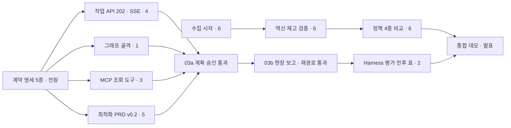

# 역할 분담과 작업 순서 (6인)

| 항목 | 내용 |
| --- | --- |
| 문서 상태 | 초안 v0.2 |
| 작성일 | 2026-10-20 |
| 기준 | [전체 구성도](images/architecture.png), [뷰 7종](images/views/), AI-Agent Capstone(+MCP) 평가표 |

> 프론트엔드 전담은 두지 않고, 각자 자기 기능의 화면을 만든다.

---

## 1. 한눈에 보기

| # | 역할 | 맡는 컨테이너·모듈 | 맡는 화면 | 평가표 항목 (배점) |
| --- | --- | --- | --- | --- |
| 1 | 에이전트 그래프 | `agent` (LangGraph) | 관제 작업 화면, 승인 카드 | AI Agent 설계 15, 구현 15 |
| 2 | Harness · 평가 · 품질 | `agent` (Harness), LangSmith | 작업 이력, 기사 화면 | Harness 20 |
| 3 | MCP · RAG | `business-mcp`, `rag-mcp`, `vectordb`, `rag-indexer` | 근거 패널 | MCP 설계·구현 20 |
| 4 | 백엔드 | `backend` (Spring Boot) | 공통 뼈대 (로그인, API, SSE) | 인증 10, 대기열 가산점 10 |
| 5 | 최적화 · 인프라 | `optimizer`, `osrm`, `docker-compose`, CI | 지도 · 계획 검토 | 아키텍처 설계 10 (공동) |
| 6 | 데이터 분석 · 시뮬레이터 | `analysis/`, 예측 모델, `sim` | 성과 리포트 | Biz. 아이템 10 (근거), 아키텍처 (공동) |

**기획 리드:** PRD·아키텍처 문서 갱신, 현장 인터뷰, 발표 준비를 책임진다. 팀에서 한 명을 정한다.

---

## 2. 작업 순서

### 2.1 핵심 경로

⚠️ **4 백엔드가 핵심 경로에 가장 많이 걸려 있다.** 작업 API·SSE가 늦으면 화면, 에이전트, MCP가 모두 밀린다. M2까지는 4의 일을 다른 사람이 가져가지 않도록 범위를 지킨다.

### 2.2 단계별 작업

| 단계 | 완료 조건 | 1 에이전트 | 2 Harness | 3 MCP·RAG | 4 백엔드 | 5 최적화·인프라 | 6 데이터·시뮬 |
| --- | --- | --- | --- | --- | --- | --- | --- |
| **M0 첫날** | 수집이 돌고 있음 | | | | | 레포 구조 | **실시간 수집 시작** |
| **M1 계약** | 계약 명세 5종 승인, 가짜 구현 업로드 | 진행 이벤트 명세 | Harness 기준값 초안 | MCP 도구 명세 | OpenAPI, `/internal`, Kafka 명세 | `solve` 명세, Compose 골격 | `predict()` 시그니처, 데이터 명세 |
| **M2 뼈대** | 로그인 → 작업 202 → SSE 수신 | 그래프 골격 (LLM 없이 `interrupt`·재개) | LangSmith 연결, Agent Loop 한도 | 조회 도구 6개 (가짜 `/internal`) | 인증 JWT, 작업 API, SSE, 공통 프론트 뼈대 | OR-Tools PRD v0.2 반영, `solve` 소비 | 역산 재고 검증, 베이스라인 예측, 재생 엔진 |
| **M3 계획 승인** | **03a 시퀀스 통과** | 모델의 도구 선택, 승인 카드 화면 | Guardrails, Recovery | 계산·변경 도구, `rag-mcp`, 색인 | `/internal` 실제 구현, 승인 API | 지도·계획 검토 화면 | 현행 운영 재현 정책 |
| **M4 현장 보고** | **03b 시퀀스 통과** | 보고 해석·재경로 노드 | 기사 화면, 마스킹 | 근거 패널 화면 | 보고 API, 변경 등급 규칙, 재시도·DLQ | 재경로, 재시도·DLQ 지원 | 피처 확장, 재고 0 보정 |
| **M5 평가** | 정책 4종 표, Harness 전후 표 | 상황 반영·질의 노드 | 평가셋 실행, ISO/IEC 25010 매핑 | ToolError 개선 (평가 결과 반영) | 성과 조회 API | 성능 측정 (재경로 10초) | LightGBM, 정책 비교, 성과 리포트 화면 |
| **M6 마무리** | 통합 데모 리허설 | 데모 시나리오 점검 | 장애 시연 스크립트 | 근거 문서 보강 | 보안 점검 (공개 포트, 권한) | 배포 리허설 | 기획 리드: PRD·발표 |

### 2.3 순서를 지켜야 하는 이유

- **수집은 첫날 켠다.** 며칠 쌓여야 역산 재고를 검증할 수 있고, 그 결과로 운영 상한(만차 정의)이 정해진다.
- **계약 명세가 끝나기 전에는 기능을 만들지 않는다.** 계약이 바뀌면 화면, 에이전트, MCP가 같이 다시 짜인다.
- **03a를 먼저 끝낸다.** 계획 승인 흐름에 작업 API, 그래프, MCP, 최적화, 승인 화면이 모두 들어 있어서, 이것이 돌면 03b는 노드와 화면을 추가하는 일이 된다.
- **평가는 03b 이후에 한다.** Harness 평가셋은 현장 보고 시나리오(진입 불가, 재고 불일치)를 쓰기 때문이다.

---

## 3. 역할별 작업

### 1. 에이전트 그래프

- [ ] `ShiftState`와 그래프: 계획 초안, 보고 해석·재경로, 상황 반영, 질의
- [ ] MCP Client로 두 서버 연결 (`mcpServers`, 도구 접두어 `business_`, `rag_`)
- [ ] 모델이 도구를 고르고 근거와 함께 답하는 노드
- [ ] 변경 도구 앞 `interrupt`, checkpointer 저장, 같은 `thread_id`로 재개
- [ ] `ai.tasks` 소비, `ai.events` 발행
- [ ] 화면: 관제 작업 화면 (요청 입력, 진행 이벤트 로그), **승인 카드 컴포넌트 (M3 전에 공유)**

**완료 기준:** 03a·03b 시퀀스가 실제로 돈다. **금지:** 업무 DB 직접 쓰기 (checkpointer만 허용), 숫자를 모델이 만들기.

### 2. Harness · 평가 · 품질

- [ ] Instructions: `prompts/*.md` 버전 관리
- [ ] Tools: 결과 길이 제한, 오류는 ToolMessage
- [ ] Context: 토큰 예산, 넘으면 요약, RAG 근거 주입
- [ ] Agent Loop: 최대 8턴, 작업 120초, 같은 도구 3회
- [ ] Guardrails: 변경 도구 승인, 기사 이름·연락처·위치 마스킹
- [ ] Recovery: 429·503 2회 재시도, 대체 모델, FAILED
- [ ] Observability: LangSmith, `trace_id`를 Kafka 헤더·로그·작업 이력에 전파
- [ ] 평가셋: 불꽃축제 대여 중지, 진입 불가, 재고 불일치, 트럭 부족. 변경 전후 결과표
- [ ] ISO/IEC 25010 품질 특성 매핑
- [ ] 화면: 작업 이력 (상태, FAILED, 재시도 횟수, trace 링크), 기사 화면 (보고 폼, 변경 제안 수락)

**완료 기준:** 한 작업의 Node·도구·토큰·지연·비용이 `trace_id` 하나로 보이고, 평가셋 전후 표가 남는다.

### 3. MCP · RAG

- [ ] `business-mcp` 도구 10개 ([05 연결 뷰](images/views/05-mcp-connection.png)): 조회 6, 계산 1, 변경 3
- [ ] docstring에 단위까지, 변경 도구에 `destructiveHint`, `ToolError`에 재시도 정보
- [ ] `rag-mcp`: `search_docs`가 chunk와 출처를 반환, Resource `doc://{doc_id}` (**1개 이상 필수**)
- [ ] `rag-indexer`: Chunking → Embedding(모델 이름·차원 기록) → Indexing(출처·버전)
- [ ] 근거 문서: 재배치 운영 기준, 서울시 공지, 역산 분석 보고서 요약, 인수인계 요약 양식
- [ ] 인메모리 Client로 도구 단위 테스트
- [ ] 화면: 근거 패널 (출처 목록, 원문 보기)

**완료 기준:** agent가 Streamable HTTP로 두 서버의 도구를 찾아 호출하고, 잘못된 인자에 대한 오류 메시지를 보고 다시 호출한다. **금지:** `business-mcp`의 DB 직접 접근·업무 규칙 복제, `rag-mcp`의 업무 데이터 변경.

### 4. 백엔드

- [ ] 업무 API `/api/**`: 대여소, 계획, 변경안, 현장 보고, 성과
- [ ] 작업 API: `POST /api/ai/tasks` → 202, `GET .../{id}`, `GET .../{id}/stream`(SSE), `POST .../{id}/approval`, `GET /api/ai/tasks?mine=true`
- [ ] `/internal/**` (docker network 안에서만)
- [ ] 인증: Spring Security + JWT, 역할 `MANAGER` · `DRIVER` · `EXECUTIVE`, 기사는 자기 트럭만
- [ ] 변경 등급 규칙, 승인 기록, 감사 로그
- [ ] Kafka 발행·소비, 실패 시 `*.retry` → `*.dlq`
- [ ] 따릉이·기상청 수집 스케줄러, PostgreSQL 스키마 (Flyway)
- [ ] 화면: 공통 뼈대 (Vue 프로젝트, 로그인, 라우팅, `useApi()`, `useTaskStream()`)

**완료 기준:** 로그인한 관리자가 작업을 만들면 202를 받고 SSE로 진행 이벤트가 오며, 실패한 작업이 재시도 후 DLQ에 쌓인다. **금지:** LLM 호출.

### 5. 최적화 · 인프라

- [ ] OR-Tools를 PRD v0.2에 맞추기: 트럭 용량 15대, 거치대 상한은 설정값, 빈 대여소 우선 벌점, 시간 차원, 탐색 한도는 해 개수로 고정
- [ ] 재경로: 현재 위치·적재량에서 남은 정류장만 다시 풀기
- [ ] `solve.requests` 소비 → `solve.results` 발행 (요청 ID로 중복 방지)
- [ ] OSRM, 이동 시간 행렬 캐시
- [ ] `docker-compose.yml`, `topics-init`, `.env` 템플릿, GitHub Actions CI
- [ ] 화면: 지도 · 계획 검토 (트럭 경로, 포기 거점과 사유)

**완료 기준:** `docker compose up` 한 번으로 전체가 뜨고, 대여소 200곳·트럭 5대 재경로가 10초 안에 나온다. **금지:** LLM 호출, DB 직접 접근.

### 6. 데이터 분석 · 시뮬레이터

- [ ] **첫날** 실시간 API 수집 시작 (5~10분 간격)
- [ ] 역산 재고(배치 직전 2대, 회수 직전 31대) 검증 → 운영 상한 결정, 역산 기준값 민감도
- [ ] 대여소 역할 분류, 데모 권역 선정 근거
- [ ] 수요 예측: 베이스라인 → LightGBM, 피처(고도·역할·공휴일·날씨·행사), 재고 0 구간 보정
- [ ] 시뮬레이터: 대여이력 재생, 정책 4종 (재배치 없음, 단순 규칙, 현행 운영 재현, 본 시스템)
- [ ] 지표: 빈 대여소-분(주 지표), 과적재 대여소-분, 트럭-시간당 해소 대수
- [ ] 화면: 성과 리포트 (정책 4종 비교)

**완료 기준:** 같은 날짜·같은 트럭 수에서 네 정책의 지표표가 나오고, 예측 모델이 베이스라인보다 낫다는 검증 결과가 있다.

---

## 4. 화면 공동 개발 규칙

- 4가 M2에 공통 뼈대(로그인, `useApi()`, `useTaskStream()`)를 올리기 전에는 각자 화면을 시작하지 않는다.
- UI 라이브러리는 M1에 하나로 정한다.
- 폴더 단위로 나눈다: `src/features/{task-console, approval, task-history, driver, evidence, plan-map, report}`. `src/shared`는 4의 승인이 필요하다.
- API 타입은 OpenAPI에서, 이벤트 타입은 이벤트 JSON Schema에서 생성한다.
- 백엔드가 준비되기 전에는 OpenAPI 기반 가짜 API(MSW 등)로 개발한다.

---

## 5. 운영 규칙

- **CODEOWNERS:** 모듈·화면 폴더마다 담당자 한 명이 PR 승인권을 가진다. 계약 명세는 쓰는 사람과 쓰는 쪽 대표 두 명 이상 승인.
- **주간 통합 데모:** 매주 `docker compose up` 한 번으로 전체가 뜨는지 확인한다.
- **금지 사항 점검:** 평가에서 구성 요소별 금지 사항 위반을 본다. PR마다 해당 모듈의 금지 사항을 체크한다.
- **부하 조정:** M3 이후 5는 4의 재시도·DLQ를 돕는다. 1·4가 밀리면 M2~M3 범위를 줄이되 03a 통과를 최우선으로 둔다.
