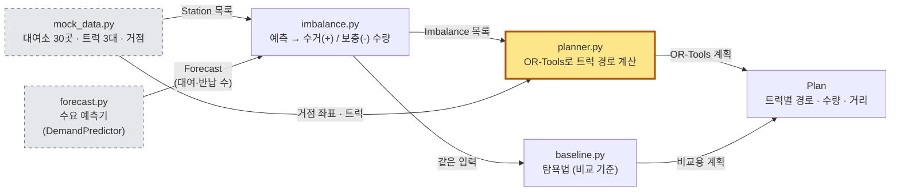
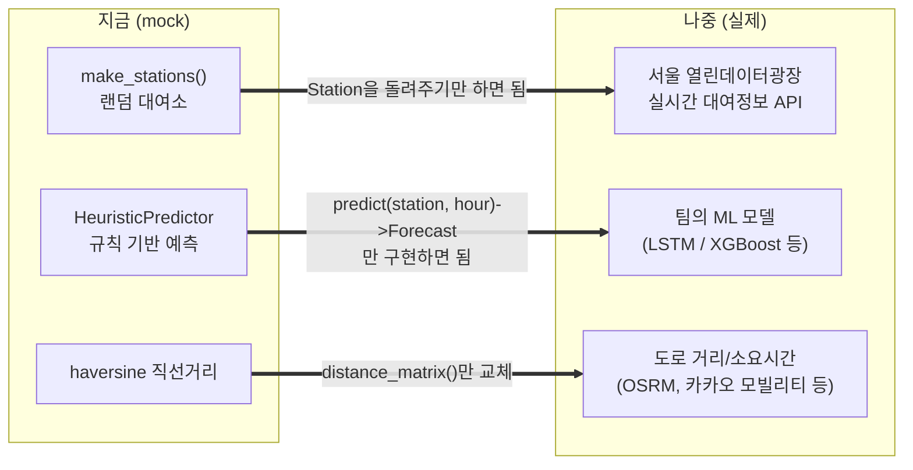

<!--
Author: Jung Minkyu
Date: 20OCT2026
Purpose: Architecture and component map of the OR-Tools rebalancing example, with replacement points for real data.
-->

# 01. 아키텍처 구성도

## 1. 이 프로그램이 푸는 문제

```text
          아침 8시

  [강남-06]  자전거 17대 / 30칸        [잠실-05]  자전거 5대 / 20칸
   ▓▓▓▓▓▓▓▓▓░░░░░  → 곧 반납이 몰려서 넘친다   ▓▓░░░░░░  → 곧 대여가 몰려서 빈다

   남는 곳에서 빼서, 모자란 곳에 채워야 한다.  그런데 트럭은 한정되어 있다.
   → "누가, 어디를, 어떤 순서로, 몇 대씩?" 을 계산해 주는 프로그램
```

## 2. 전체 구성도



> 모든 상자는 `models.py`에 정의된 데이터 모양(Station, Truck, Forecast, Imbalance, Plan)으로 서로 대화한다.

- **점선 회색 상자 = 가짜(mock)**. 나중에 실제 API와 팀 AI 모델로 바꾼다.
- **노란 상자 = OR-Tools가 쓰이는 유일한 곳**. 나머지 파일은 OR-Tools를 전혀 모른다.
- 화살표에 적힌 **데이터 이름**(Station, Forecast, Imbalance, Plan)이 계층 사이의 "계약"이다.

## 3. 파일별 역할

| 파일 | 한 줄 역할 | OR-Tools를 아는가 |
|---|---|---|
| `models.py` | 데이터 모양 정의 (Station, Truck, Forecast, Imbalance, Stop, Route, Plan) | 아니오 |
| `mock_data.py` | 가짜 대여소 30곳, 트럭, 거점을 만든다 | 아니오 |
| `forecast.py` | "다음 구간(N시간, 예시는 1시간) 대여·반납 수"를 돌려주는 예측기. 지금은 규칙 기반 흉내 | 아니오 |
| `imbalance.py` | 예측을 보고 "몇 대를 빼야/채워야 하는지" 계산 | 아니오 |
| `geo.py` | 두 좌표 사이 거리(m) 계산 | 아니오 |
| **`planner.py`** | **문제를 OR-Tools에 맞게 번역해 풀고, 답을 `Plan`으로 되돌린다** | **예 (유일)** |
| `baseline.py` | 가까운 곳부터 가는 단순 방식. 비교 기준 | 아니오 |
| `__main__.py` | 위 부품을 순서대로 연결해 실행하고 출력 | 아니오 |

## 4. 왜 이렇게 나눴나: "좁은 계약"


두 쪽이 주고받는 것은 **`Imbalance` 목록 하나뿐**이다. 그래서

- AI 모델을 다른 모델로 바꿔도 `planner.py`는 한 줄도 안 바뀐다.
- OR-Tools를 다른 솔버로 바꿔도 AI 쪽은 모른다.
- 한쪽만 따로 테스트할 수 있다 (`tests/`는 예측 없이 `Imbalance`만 만들어 솔버를 검증한다).

팀 프로젝트에서 AI 담당과 최적화 담당이 서로 기다리지 않고 작업할 수 있는 구조다.

## 5. 교체 지점: mock을 실제로 바꾸려면



| 바꿀 곳 | 방법 | `planner.py`/`imbalance.py` 수정 |
|---|---|---|
| 대여소 데이터 | API 응답을 `Station`으로 변환하는 함수 작성 | 불필요 |
| 수요 예측 | `DemandPredictor`를 구현한 클래스를 `compute_imbalances`에 넘김 | 불필요 |
| 거리 | `geo.distance_matrix`를 도로 거리 버전으로 교체 | 불필요 |

## 6. 이 구조를 한마디로

> **"입력을 만드는 부분(데이터 + 예측)"과 "결정을 내리는 부분(불균형 계산 + OR-Tools)"을 `Imbalance`라는 얇은 경계로 나눈 파이프라인.**
> 입력은 mock이지만 결정을 내리는 부분은 실제 코드다.

다음 문서에서는 이 구조 위로 **실제 숫자가 어떻게 흘러가는지** 따라가 본다 → [02-pipeline-walkthrough.md](02-pipeline-walkthrough.md)
