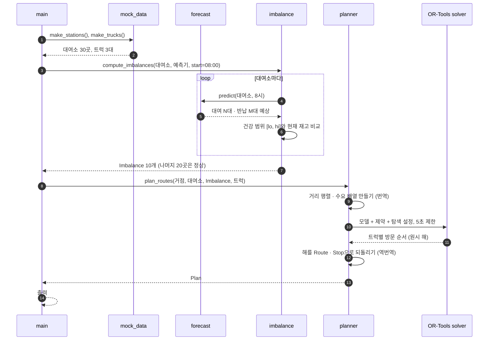

<!--
Author: Jung Minkyu
Date: 20OCT2026
Purpose: Step-by-step trace of real data (hour=8, seed=7) through every stage of the rebalancing pipeline.
-->

# 02. 파이프라인 따라가기 (실제 숫자)

`python -m rebalancing --hour 8 --trucks 3` 한 번의 실행에서 **데이터가 단계마다 어떻게 모양이 바뀌는지** 실제 값으로 따라간다.
(seed=7, 아침 8시. 아래 숫자는 모두 실제 실행 결과다.)

## 1. 실행 흐름 (시퀀스)



핵심은 ⑨~⑫다. **OR-Tools는 "번역된 문제"를 받아 "방문 순서"만 돌려준다.** 번역과 역번역은 `planner.py`가 한다.

## 2. 단계별 데이터 변화 한눈에


데이터 개수가 **30 → 30 → 10 → 11 → 10**으로 변하는 것에 주목하자. 정상인 대여소 20곳은 ③에서 걸러져서 OR-Tools는 아예 보지 않는다. **OR-Tools가 푸는 문제를 작게 만드는 것도 불균형 계산의 역할이다.**

---

## 3. 단계 ① → ② : 대여소와 예측 (mock)

| id | 이름 | 유형 | 용량 | 현재 재고 | 예측 대여 (구간 동안) | 예측 반납 (구간 동안) |
|---|---|---|---|---|---|---|
| 3 | 강남-04 | 업무지구 | 20 | 18 | 5 | 13 |
| 0 | 강남-01 | 업무지구 | 25 | 1 | 5 | 16 |
| 28 | 잠실-05 | 주거지 | 20 | 5 | 15 | 3 |

> **예측 구간이란?** 예측값이 "얼마 동안의" 대여·반납 수인지를 정하는 시간 길이이며, 이 문서에서는 **N시간**이라고 부른다.
> - 코드에는 N이라는 값이 따로 없다. 예측기가 `hour`(몇 시대인지) 하나를 받아 그 시간대의 대여·반납 수를 돌려주는 방식이라, **예측기가 정하는 시간 단위가 곧 N**이다.
> - 이 문서의 계산 예시는 **N=1시간(1시간 단위로 예측한다고 가정)** 으로 쓴다. 이 값은 설명을 위한 가정이고 코드가 강제하는 것이 아니다. 30분이나 2시간 단위 예측기로 바꾸면 N이 바뀌고, 아래 계산 방법은 그대로 쓰인다.

mock 예측기는 "아침 7~9시에 업무지구는 반납이 몰리고, 주거지는 대여가 몰린다"는 규칙으로 숫자를 만든다. **실제 AI 모델이 들어와도 이 표의 마지막 두 열(대여·반납 예측)만 달라진다.**

## 4. 단계 ② → ③ : 예측을 "얼마나 옮길지"로 바꾸기

### 아이디어: 예측 구간이 끝난 뒤에도 괜찮은 재고인가?

예측 구간(N시간)이 끝난 시점의 재고는 이렇게 계산된다. (예시는 N=1시간)

```
구간 종료 시점 재고 = 현재 재고 - 대여(N시간 동안) + 반납(N시간 동안)
```

이 값이 **0 이상(안전재고 포함)이고 용량 이하**여야 "대여 불가"도 "반납 불가"도 안 생긴다. 이 조건을 거꾸로 풀면 **지금 재고가 있어야 하는 범위 `[lo, hi]`** 가 나온다.

```
lo = 대여 - 반납 + 안전재고(2)      (너무 적으면 비는 걸 막기 위한 하한)
hi = 용량 + 대여 - 반납             (너무 많으면 넘치는 걸 막기 위한 상한)
```

```
재고 0 ───────[ lo ======= 건강 범위 ======= hi ]─────── 용량
              ↑ 이 아래면 보충 필요(-)        ↑ 이 위면 수거 필요(+)
```

### 세 대여소로 직접 계산

**강남-04** (용량 20, 재고 18, 대여 5, 반납 13)
- 구간 종료 시점(N=1 가정): 18 - 5 + 13 = **26 > 20** → 넘친다!
- hi = 20 + 5 - 13 = 12, 현재 18 > 12 → **6대 수거 (+6)**

**강남-01** (용량 25, 재고 1, 대여 5, 반납 16)
- 재고가 1대뿐이라 비어 보이지만, 구간 종료 시점(N=1 가정): 1 - 5 + 16 = **12** → 괜찮다.
- lo = 0, 현재 1 ≥ 0 → **정상 (0)**. *"지금 비었다 ≠ 문제"인 이유: 곧 반납이 들어오기 때문.* 단순 규칙으로는 못 잡고 **예측이 있어야 알 수 있는 부분**이다.

**잠실-05** (용량 20, 재고 5, 대여 15, 반납 3)
- 구간 종료 시점(N=1 가정): 5 - 15 + 3 = **-7 < 0** → 빈다!
- lo = 15 - 3 + 2 = 14, 현재 5 < 14 → **9대 보충 (-9)**

### 결과: 30곳 중 10곳이 불균형

| 대여소 | delta | 행동 | | 대여소 | delta | 행동 |
|---|---|---|---|---|---|---|
| 종로-06 | +13 | 수거 | | 잠실-02 | -4 | 보충 |
| 강남-04 | +6 | 수거 | | 잠실-03 | -4 | 보충 |
| 종로-04 | +5 | 수거 | | 잠실-04 | -3 | 보충 |
| 여의도-01 | +5 | 수거 | | 잠실-05 | -9 | 보충 |
| 강남-06 | +4 | 수거 | | | | |
| 여의도-05 | +1 | 수거 | | | | |

합계: **남는 자전거 34대(수거), 모자란 자전거 20대(보충)**. 업무지구에서 빼서 주거지(잠실)에 채우는 그림이 보인다.

> 여기까지 OR-Tools는 한 번도 나오지 않았다. 지금까지는 "무엇을 해야 하는가"를 정리한 것뿐이다.

## 5. 단계 ③ → ④ : OR-Tools에 넣을 모양으로 번역

`planner.py`가 `Imbalance` 10개를 **번호 붙은 노드**로 바꾼다. 0번은 거점(출발지)이다.

| 노드 | 장소 | 수요 (demand) | 거점에서 거리 |
|---|---|---|---|
| 0 | 거점 (서울시청 인근) | 0 | – |
| 1 | 강남-04 | +6 | 9,744m |
| 2 | 강남-06 | +4 | 9,624m |
| 3 | 종로-04 | +5 | 1,457m |
| 4 | 종로-06 | +13 | 449m |
| 5 | 여의도-01 | +5 | 8,120m |
| 6 | 여의도-05 | +1 | 7,471m |
| 7 | 잠실-02 | -4 | 12,813m |
| 8 | 잠실-03 | -4 | 12,156m |
| 9 | 잠실-04 | -3 | 12,050m |
| 10 | 잠실-05 | -9 | 13,813m |

여기에 노드 사이 **전체 거리표(11×11)** 도 함께 만든다. OR-Tools에게 건네는 문제는 결국 이것이다.

```
노드 11개, 차량 3대(각 용량 20)
수요      = [0, +6, +4, +5, +13, +5, +1, -4, -4, -3, -9]
거리표    = 11×11 (미터)
규칙      = 트럭 안 자전거 수는 항상 0 이상 20 이하
목표      = 총 이동거리를 줄여라 (못 가는 곳은 벌점 받고 포기 가능)
```

## 6. 단계 ④ → ⑤ : OR-Tools가 돌려준 답

OR-Tools는 이 문제를 받아 5초간 탐색한 뒤 **방문 순서**를 돌려준다. `planner.py`가 이를 읽기 좋게 바꾼 결과:

```
트럭 2번 (출발 시 자전거 2대, 총 42.3km)

 순서  장소        행동        트럭 안 자전거 수
  0   거점         출발                      2
  1   종로-06      수거 +13                 15
  2   종로-04      수거 +5                  20   ← 가득 참 (용량 한계)
  3   잠실-03      보충 -4                  16
  4   잠실-02      보충 -4                  12
  5   잠실-05      보충 -9                   3
  6   잠실-04      보충 -3                   0
  7   강남-04      수거 +6                   6
  8   강남-06      수거 +4                  10
  9   여의도-01    수거 +5                  15
 10   여의도-05    수거 +1                  16
  –   거점         복귀
```

트럭 안 자전거 수의 변화를 그려 보면 OR-Tools가 어떤 "생각"을 했는지 보인다.

```
(█ 한 칸 = 자전거 1대)
거점 출발           2대 ██
종로-06  수거 +13  15대 ███████████████
종로-04  수거 +5   20대 ████████████████████  ← 가득 참 (용량 20)
잠실-03  보충 -4   16대 ████████████████
잠실-02  보충 -4   12대 ████████████
잠실-05  보충 -9    3대 ███
잠실-04  보충 -3    0대 ·  ← 텅 빔
강남-04  수거 +6    6대 ██████
강남-06  수거 +4   10대 ██████████
여의도-01 수거 +5   15대 ███████████████
여의도-05 수거 +1   16대 ████████████████
```

### OR-Tools가 찾아낸 경로가 똑똑한 이유

1. **가까운 종로부터 가득 채운다.** 종로-06은 거점에서 449m라서 먼저 들러 18대(13+5)를 싣는다.
2. **그 상태로 잠실로 이동해 한 번에 비운다.** 잠실에 필요한 20대(4+4+9+3)를 모두 내려놓아 트럭이 정확히 0대가 된다.
3. **빈 트럭으로 돌아오며 남은 곳을 수거한다.** 강남 → 여의도 순서로 돌아 거점으로 복귀한다.
4. **용량 제약을 정확히 지킨다.** 종로-04 직후 트럭이 20대(용량 한계)라서 더 실을 수 없고, 내려놓을 수 있는 곳(잠실)으로 가야 한다. "수거만 쭉 하면 용량을 넘는다"는 순서 규칙은 우리가 코딩한 게 아니라 제약에서 OR-Tools가 스스로 찾아낸 것이다.

## 7. 같은 문제를 탐욕법으로 풀면 (비교)

탐욕법은 "지금 위치에서 **가장 가까운 곳**을 방문"을 반복한다.

```
탐욕법 트럭 0 (49.4km):
 거점 → 종로-04 → 여의도-05 → 강남-06 → 잠실-04 → 잠실-05 → 잠실-02 → 잠실-03 → 강남-04 → 종로-06 → 거점
 트럭 1 (16.2km): 거점 → 여의도-01 → 거점
```

- 종로-06(거점에서 449m)을 **마지막**에 간다. 가까워서 나중에 해도 된다고 미뤘다가, 용량 때문에 돌아가야 했다.
- 강남을 **두 번** 지난다 (강남-06, 나중에 강남-04).
- 결국 **트럭 2대, 65.6km**를 쓴다.

| | 탐욕법 | OR-Tools |
|---|---|---|
| 트럭 | 2대 | 1대 |
| 총 거리 | 65.6km | 42.3km |
| 옮긴 자전거 | 54대 | 54대 |

**같은 일을 하는데 거리 35% 감소.** 탐욕법은 "지금 가장 가까운 곳"만 보지만, OR-Tools는 "전체 순서를 한꺼번에" 보고 비교하기 때문이다.

> 주의: 이것은 가짜 데이터 한 건의 결과다. "35% 절감"을 일반 결론으로 말하지 말고, **"이 입력에서는 이렇게 달랐다"** 로 말해야 한다.

## 8. 이 흐름이 보여주는 것

| 질문 | 답 |
|---|---|
| mock에서 가짜인 부분은? | 대여소 데이터(②의 입력)와 수요 예측 |
| 진짜인 부분은? | 불균형 계산(③)과 OR-Tools 경로 계산(④→⑤) |
| 실제 데이터를 넣으면 코드 수정이 필요한가? | 입력 어댑터만. ③, ④, ⑤는 그대로 |
| 이 실행이 증명한 것은? | 예측부터 경로까지 **끝까지 연결되어 동작**하고 **제약이 지켜진다** |
| 증명하지 못한 것은? | 실제 서울 데이터에서의 절감 효과 |

다음 문서에서는 ④→⑤, 즉 **OR-Tools 부분을 확대해서** 코드와 함께 살펴본다 → [03-ortools-explained.md](03-ortools-explained.md)
