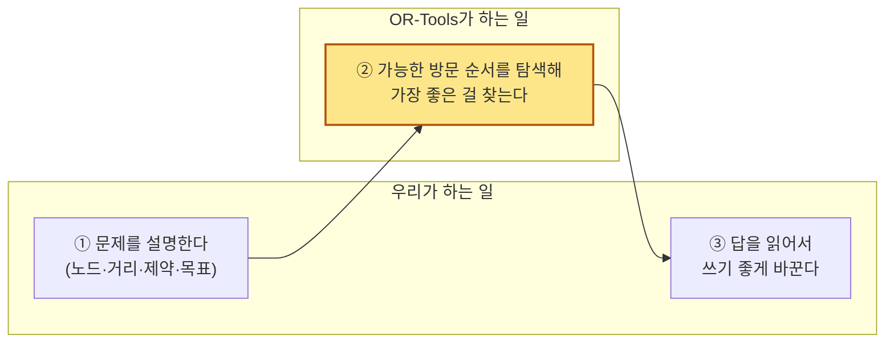
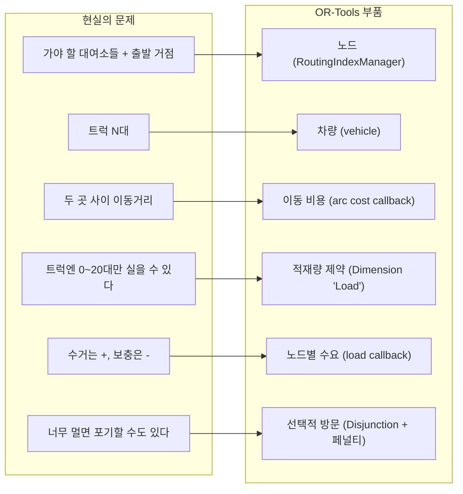
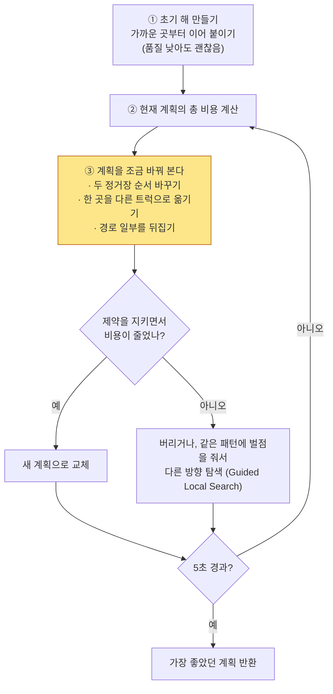

<!--
Author: Jung Minkyu
Date: 20OCT2026
Purpose: Explains how planner.py translates the rebalancing problem for OR-Tools and what the solver does internally.
-->

# 03. OR-Tools는 코드에서 어떻게 쓰이나

가장 어렵게 느껴지는 부분이라 **작은 단계로 쪼개서** 설명한다. 코드는 모두 `rebalancing/planner.py`의 실제 코드다. (읽기 쉽게 타입 표기와 enum 경로 등 일부를 줄여 적었다.)

## 1. 가장 중요한 한 가지

OR-Tools를 쓴다는 것은 **"어떻게 풀지" 코딩하는 게 아니라 "무엇이 문제인지" 설명하는 것**이다.



비유하면 **내비게이션 앱**이다. 우리는 목적지와 조건("고속도로 피하기")만 입력하고, 길 찾기는 앱이 한다. 우리는 "A 다음에 C로 가라"를 코딩하지 않는다.

## 2. 번역표: 현실 → OR-Tools



## 3. 코드 읽기: 6조각

### 조각 1. 노드와 차량 만들기

```python
manager = pywrapcp.RoutingIndexManager(len(points), len(trucks), DEPOT)
routing = pywrapcp.RoutingModel(manager)
```

- "노드 11개, 차량 3대, 모두 0번 노드(거점)에서 출발"이라고 알린다.
- `manager`는 우리가 쓰는 번호(노드 번호)와 OR-Tools 내부 번호(index)를 변환해 주는 역할이다. 헷갈리면 "번호표 교환기"로 생각하면 된다.

### 조각 2. 이동 비용: "A에서 B까지 얼마야?"

```python
def distance_cb(a, b):
    return dist[manager.IndexToNode(a)][manager.IndexToNode(b)]

transit = routing.RegisterTransitCallback(distance_cb)
routing.SetArcCostEvaluatorOfAllVehicles(transit)
```

- **콜백(callback)** = OR-Tools가 탐색하다가 "A에서 B 가는 비용이 뭐였지?" 하고 **우리에게 물어보는 함수**다.
- 우리는 미리 만든 거리표(`dist`)에서 값을 찾아 대답만 하면 된다.
- 이 한 줄로 "총 비용 = 이동거리의 합"이 목표로 정해진다.

### 조각 3. 적재량 제약: 이 프로젝트의 핵심

```python
def load_cb(index):
    return demand[manager.IndexToNode(index)]   # 수거면 +, 보충이면 -

load_idx = routing.RegisterUnaryTransitCallback(load_cb)
routing.AddDimensionWithVehicleCapacity(
    load_idx,
    0,                              # 여유(slack) 없음
    [t.capacity for t in trucks],   # 트럭마다 최대 20
    False,                          # 거점에서 이미 실은 채로 출발 가능
    "Load",
)
```

**Dimension(차원)** 은 "경로를 따라가며 누적되는 값"을 추적하는 장치다. 여기서는 "트럭에 실린 자전거 수"다.

```
 거점  →  종로-06  →  종로-04  →  잠실-03  →  ...
  2        15         20         16
      +13        +5        -4
  └ 누적값(Load) ┘
```

- 각 정거장에서 `demand`만큼 값이 더해지거나(수거 +) 빠진다(보충 -).
- 누적값이 **항상 0 이상 20 이하**여야 한다는 규칙을 건 것이다.
- 이 규칙 하나로 두 가지가 자동으로 지켜진다.
  - 용량 초과 금지 (수거를 너무 이어서 하면 20을 넘으므로 불가능)
  - **실은 만큼만 내려놓기** (보충을 먼저 많이 하면 0 아래로 내려가므로 불가능)
- 마지막 `False`는 "거점에서 이미 자전거를 싣고 출발해도 된다"는 뜻이다. 거점 재고가 충분하다는 가정이다.

### 조각 4. 못 가는 곳은 벌점 내고 포기

```python
for node in range(1, len(points)):
    routing.AddDisjunction([manager.NodeToIndex(node)], penalty_per_bike_m * abs(demand[node]))
```

- `AddDisjunction`은 "이 노드는 방문하지 않아도 된다. 대신 **벌점**을 낸다"는 뜻이다.
- 벌점 = 3,000m × 처리 못 한 자전거 수. 거리와 같은 단위(m)로 맞춰서, 솔버가 둘을 직접 비교할 수 있게 했다.

| 상황 | 솔버의 판단 |
|---|---|
| 종로-06(13대)을 가려면 2km 더 돈다 | 벌점 39,000 > 2,000 → **간다** |
| 5대짜리를 위해 40km 돌아야 한다 | 벌점 15,000 < 40,000 → **포기한다** |

이걸 넣지 않으면 모든 곳을 반드시 방문해야 해서, 트럭이 모자란 순간 **"해 없음"** 이 되어버린다. 벌점이 있으면 항상 "가장 덜 나쁜 계획"을 낸다.

### 조각 5. 탐색 방법과 시간 정하기

```python
params.first_solution_strategy = PATH_CHEAPEST_ARC
params.local_search_metaheuristic = GUIDED_LOCAL_SEARCH
params.time_limit.seconds = 5
solution = routing.SolveWithParameters(params)
```

- 첫 번째 줄: **일단 쓸 만한 경로 하나 만드는 방법** (가까운 곳부터 이어 붙이기)
- 두 번째 줄: **그 경로를 계속 개선하는 방법** (아래 4장 참고)
- 세 번째 줄: 5초 안에 찾은 최선을 반환

### 조각 6. 답 읽기: 방문 순서 → 우리 데이터

```python
index = routing.Start(v)
while not routing.IsEnd(index):
    nxt = solution.Value(routing.NextVar(index))      # 다음에 갈 곳
    load = solution.Value(load_dim.CumulVar(nxt))     # 그곳에서 일을 끝낸 뒤 트럭 안 자전거 수
    ...
    index = nxt
```

- OR-Tools는 "각 노드 다음에 어디로 가는가(`NextVar`)"를 연결 리스트처럼 돌려준다.
- 이걸 따라가며 `Stop`(장소·행동·수량·남은 적재량)을 만들어 `Plan`으로 조립하는 것이 마지막 일이다.

## 4. 솔버 내부에서는 무슨 일이?



핵심 아이디어: **완벽한 답을 한 번에 구하지 않고, 괜찮은 답에서 시작해 조금씩 고쳐 나간다.** 사람이 이삿짐 순서를 짜다가 "이거랑 이거 바꾸면 더 짧네" 하며 고치는 것과 같다.

### 알아둘 점 두 가지

1. **"최적(optimal)"을 보장하지 않는다.** 시간 제한 안에서 찾은 "아주 좋은 답"이다. 발표에서는 *"탐욕법보다 개선된 경로"* 라고 말하는 것이 정확하다.
2. **같은 입력이면 거의 같은 답**이 나오지만 시간 제한(5초) 때문에 컴퓨터 성능에 따라 미세하게 달라질 수 있다.

## 5. 파라미터 = 운영 정책

코드 속 숫자 하나하나가 곧 **운영 방침**이다. 이 감각이 "OR-Tools 이해"의 반이다.

| 코드 | 값 | 현실의 의미 | 올리면 / 내리면 |
|---|---|---|---|
| `penalty_per_bike_m` | 3,000 | 자전거 1대를 방치하는 손해를 "3km 운행"으로 환산 | 올리면 멀어도 꼭 처리, 내리면 쉽게 포기 |
| `truck_fixed_cost_m` | 2,000 | 트럭 1대 출동 비용을 "2km 운행"으로 환산 | 올리면 트럭 적게 쓰고 오래 돌기, 내리면 트럭 여러 대로 분산 |
| `time_limit_s` | 5 | 계획 계산에 쓸 시간 | 올리면 더 좋은 계획, 내리면 빠른 응답 |
| `trucks[].capacity` | 20 | 트럭 한 대 적재 용량 | 줄이면 한 번에 못 싣는 큰 대여소는 포기하게 됨 (아래 참고) |

직접 확인하려면:

```bash
.venv/bin/python -m rebalancing --hour 8 --truck-capacity 8     # 용량이 작으면 처리 못 하는 곳이 생긴다
.venv/bin/python -m rebalancing --hour 18 --trucks 1            # 트럭이 부족하면 포기가 늘어난다
```

실제 결과 (seed=7):

| 실행 | OR-Tools 미처리 자전거 | 설명 |
|---|---|---|
| `--hour 8` (트럭 3대, 용량 20) | 0대 | 전부 처리 |
| `--hour 8 --truck-capacity 8` | 22대 | 종로-06(+13)처럼 **8대보다 큰 대여소는 한 번에 다 못 싣는다** |
| `--hour 18 --trucks 1` | 80대 | 트럭 한 대로는 보충 수요 104대를 감당 못 함 |

용량 8 실험에서 보이는 것은 **현재 모델의 한계**다. 이 모델은 대여소를 "통째로 처리하거나 아예 포기"만 허용한다. 용량보다 큰 대여소를 여러 번에 나눠 처리(부분 처리)하려면 한 대여소를 여러 노드로 쪼개는 확장이 필요하다. `docs/ortools-rebalancing.md` 6장(제약 확장)에 있다.

## 6. 용어사전

| 용어 | 쉬운 설명 |
|---|---|
| VRP | 여러 차량이 여러 지점을 도는 최적 경로 문제 |
| 노드(node) | 방문 후보 장소 (거점 + 불균형 대여소) |
| 콜백(callback) | 솔버가 필요할 때 우리에게 값을 물어보는 함수 (예: 거리) |
| Dimension | 경로를 따라 누적되는 양을 추적하고 한도를 거는 장치 (여기선 적재량) |
| CumulVar | Dimension의 "각 지점에서의 누적값" 변수. 솔버가 값을 정하고 우리가 읽는다 |
| Disjunction | "이 노드는 안 가도 된다, 대신 벌점" 선언 |
| 휴리스틱 | 최선을 보장하진 않지만 빨리 쓸 만한 답을 찾는 요령 |
| 메타휴리스틱 | 휴리스틱이 지역해에 갇히지 않게 도와주는 상위 전략 (Guided Local Search) |

## 7. 한 줄 정리

> `planner.py`는 **① 노드·거리·적재량·포기 벌점으로 문제를 설명하고 ② OR-Tools에게 5초 동안 풀게 한 뒤 ③ 돌려받은 방문 순서를 Plan으로 바꾼다.**
> 순서를 정하는 로직은 한 줄도 없다. 그게 OR-Tools가 대신해 주는 일이다.

다음 문서에서는 이걸 **어떻게 말로 설명하는지**를 다룬다 → [04-explain-and-faq.md](04-explain-and-faq.md)
