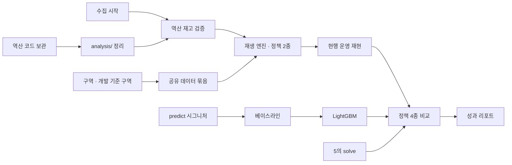

# 6. 데이터 분석 · 시뮬레이터: 작업 계획

| 항목 | 내용 |
| --- | --- |
| 문서 상태 | 초안 v0.1 (개인 작업 계획. PRD·ROLES 반영 전) |
| 작성일 | 2026-10-20 |
| 기준 | [ROLES](../ROLES.md) 3절 6번, [PRD](../PRD.md) v0.2, [따릉이 재배치 역산 정리](https://claude.ai/artifact/9nxHaGQM8VVreyMqFTxoqb) |

> 6번이 맡는 일은 다른 역할보다 먼저 시작하고, 끝나는 시점은 가장 늦다. 수집은 첫날 켜야 하고, 정책 4종 비교는 최적화와 예측이 모두 돌아야 나온다. 그 사이에 데이터 명세, 구역 경계, 예측 시그니처처럼 다른 역할이 기다리는 산출물이 있다.

---

## 1. 산출물과 받는 사람

| 산출물 | 받는 사람 | 시점 |
| --- | --- | --- |
| 실시간 재고·대여이력 수집 데이터 | 6 (검증), 4 (수집 이관) | M0 |
| 데이터 명세: 대여소 ID 대응표, station master 열, trips·재고 스키마 | 전원 | M1 |
| 계획 단위(활동 구역 17개)와 개발 기준 구역 | 4 (시드), 5 (구역별 최적화), 3 (근거 문서) | M1 |
| `predict()` 시그니처, `Forecast` 형태 | 5 (`compute_imbalances`가 호출) | M1 |
| 대여소 마스터 `analysis/out/stations.csv` (깃으로 공유) | 전원 | M1 |
| `ref.stations` 시드 CSV (위치, 거치대, 고도, 역할) | 4 | M2 |
| 베이스라인 예측기 (`HeuristicPredictor` 대체) | 5 | M2 |
| 역산 분석 보고서 요약 (RAG 근거 문서) | 3 | M3 |
| 현장 이벤트 주입 시나리오 (재고 불일치, 진입 불가, 트럭 지연) | 2 (평가셋) | M4 |
| 시뮬레이터 결과 스키마 (`sim.runs`, `sim.metrics`) | 4 (성과 조회 API) | M4 |
| LightGBM 모델 파일과 버전 | 5 (optimizer 컨테이너) | M5 |
| 정책 4종 지표표, 성과 리포트 화면 | 발표, 운영사 책임자 화면 | M5 |

---

## 2. 이미 가진 것

기존 따릉이 프로젝트(개인 저장소 `dareungi`)에서 대부분 가져다 쓸 수 있다.

| 자산 | 위치 | 쓰는 곳 |
| --- | --- | --- |
| 대여이력 상세 약 1.23억 건 (2023-07 ~ 2026-06) | `dareungi/data/processed/rent/` (Parquet), `dareungi.duckdb` `trips` | 재생 엔진, 예측 학습 |
| 자전거별 이동 순서, `relocated` 표시 | `dareungi.duckdb` `trips_seq` | 역산 재고 |
| 대여소 고도 (SRTM 30m) | `dareungi/data/interim/station_master.csv` | 대여소 마스터의 고도. 새 대여소만 새로 받음 |
| ASOS 시간별 날씨, 단기·중기예보, 공휴일 | `wx_h`, `data/raw/forecast_*`, `data/raw/calendar/` | 예측 피처 |
| 고장신고 | `fail`, `fail_std.parquet` | 역산할 때 정비 이동 제외 |
| 서울 API 호출 도우미 (키 가리기, 페이지 넘김) | `py/common.py` `fetch_all`, `py/seoul_api.py` | 수집기 |
| 시간대별 대여이력 수집기 | `py/jobs/collect_rent.py` (2026-10-10부터 AWS Lightsail 서버에서 실행 중) | 재고 검증의 짝 데이터 |
| 역산 스크립트 19개, 중간 결과 1.7GB | [analysis/rebal/](../../analysis/rebal/) (임시 보관. 입력 경로는 `dareungi`를 가리키고, 중간 결과 Parquet는 깃에서 제외) | 현행 운영 재현, 재고 복원, 활동 구역 |

### 없던 것과 채운 방법

- **실시간 대여소 재고 수집기:** [analysis/collect/bikelist.py](../../analysis/collect/bikelist.py)를 새로 만들었다. 기존 프로젝트는 대여이력, 고장, 날씨, 대여소만 모았다.
- **2026-10-10 이후 대여이력:** 로컬에는 없다. AWS 서버가 수집 중이므로, 검증할 때 서버의 `raw_rent` 사본을 받는다. 맥북에서 따로 수집하지 않는다 (같은 키라 호출량이 겹침).

---

## 3. 역산 정리에서 이 역할에 바로 쓰는 것

| 역산 결과 | 이 역할에서 쓰는 곳 |
| --- | --- |
| 활동 구역 17개 (강북 8, 강남 9). 재배치의 91%가 구역 안에서 끝남 | 서비스의 계획 단위 (전 구역, [regions.md](../data/regions.md)) |
| 강남-05(영등포·양천)와 강북-02(성동·광진): 대여소 198·186곳, 하루 재배치 369·353대, 구역 안 비율 둘 다 93%, 바쁜 날 동시 트럭 하한 둘 다 3대 | 개발 기준 구역 후보 (강남-05 제안) |
| 재고 복원 방법 (`04_stock.py`: 반납 대여소에 다음 대여까지 서 있다고 봄) | 시뮬레이터 초기 재고 |
| 방문 직전 재고: 배치 2대, 회수 31대 (실제 재고와 대조 안 함) | 실시간 수집으로 검증할 대상 |
| 반납 대여소 번호가 빈 대여 0.5% (196,108건) | 재생 규칙 필요 (5절) |
| 행사 유형 A~F, 날씨 유형 6개 | 시뮬레이터 시나리오, 예측 피처 |
| 과다 회수로 놓친 대여, 한 달 약 1,300~1,400건 | 실패 대여 지표의 근거 |
| 판단 기준값 (150m, 72시간, 하루 ±2대, 주말 비중 33%)은 임시값 | 민감도 표를 같이 남김 |

---

## 4. 작업 순서

### M0 (오늘~내일): 수집이 돌고 있음

- [x] 역산 스크립트와 중간 결과를 임시 폴더에서 `analysis/rebal/`로 옮겼다.
- [x] `bikeList` 수집기를 만들었다. 2026-10-20 14:26 첫 스냅샷은 2,716곳이다.
  - 한 번에 3페이지, 5분 간격이면 하루 864회 호출이다. 스냅샷 하나는 약 80KB, 하루 약 23MB다.
  - 열린데이터광장 안내: 1회 최대 1,000건, 호출 횟수 제한 없음 (하루 1,000회 제한은 실시간 지하철 API만 해당).
  - 저장 위치: `data/realtime/bikelist/<날짜>/<시분>.csv.gz` (깃에서 제외)
- [ ] 맥북 cron 등록:

  ```text
  */5 * * * * cd /Users/junyeop/skala_seoul_bike && /usr/bin/python3 analysis/collect/bikelist.py >> logs/bikelist.log 2>&1
  ```

- [ ] 맥북이 잠들지 않게 한다: 전원을 연결하고 덮개를 열어 둔다. 덮개를 닫으면 잠자기 상태가 되어 수집이 끊긴다.
- 대여이력은 AWS 서버가 이미 수집 중이라 맥북에서 따로 켜지 않는다.

**완료 조건:** 재고 스냅샷이 24시간 끊김 없이 쌓인다 (하루 288개 파일).

**재고와 대여이력이 같은 기간에 있어야 하는 이유:** 둘이 겹치면 트럭 재배치를 추정이 아니라 관측으로 얻는다.

```text
트럭 순반출 = (반납 − 대여) − Δ재고
```

### M1 (계약): 다른 역할이 기다리는 것

- [x] 대여소 마스터와 ID 대응표: `analysis/out/stations.csv` (3,246곳, `st_no` ↔ `st_id` 1:1, 운영 중 2,716곳 모두 매칭). 대여소 정보 API 원본을 `data/raw/stations/`에 날짜별로 받아 만든다 (`analysis/collect/stations_api.py`, 주 1회)
- [x] 데이터 명세 초안: [data-spec.md](../data/data-spec.md)
- [x] `predict()` 시그니처 초안: [predict.md](../data/predict.md) → [ ] 5와 합의
- [x] 가짜 구현: `HeuristicPredictor`를 새 시그니처로 바꿈 (`or-tools/` 4개 파일과 테스트. 테스트 6개 통과, 기존 실행 결과와 같음) → [ ] 5가 PR에서 확인
- [x] 계획 단위: 전 구역 17개로 결정 (2026-10-20). 구역이 빈 대여소 중 운영 중인 21곳은 가장 가까운 구역에 붙였다 (나머지 420곳은 운영하지 않음) ([regions.md](../data/regions.md))
- [x] 개발 기준 구역 비교, 강남-05 제안 → [ ] 팀 결정
- [x] 공유 데이터: 다른 역할에 필요한 것은 대여소 마스터 `analysis/out/stations.csv`(0.5MB)뿐이라 깃으로 공유한다. 대여이력 묶음 `data/shared/강남-05/`(182MB)는 깃헙 파일 한도(100MB)를 넘어 6이 로컬에서만 쓴다

### M2 (뼈대): 데이터만으로 첫 결과

- [ ] 역산 코드를 `analysis/`로 정리한다 (재현 순서와 입력 경로).
- [ ] 수집 5~7일 뒤 역산 재고를 검증한다: 실시간 재고와 복원 재고를 비교하고, 위 식으로 트럭 이동을 관측한다. 그 결과로 운영 상한과 트럭 용량 15대를 확인한다.
- [ ] 재생 엔진, "재배치 없음"·"단순 규칙" 정책 (개발 기준 구역 한 곳으로 먼저)
- [ ] 베이스라인 예측 (같은 요일·시간대 과거 평균)
- [ ] `ref.stations` 시드 CSV (역할: 고정 회수, 고정 배치, 변동)

**완료 조건:** 기준 시나리오 하루를 재생해 두 정책의 지표가 나온다.

### M3 (계획 승인)

- [ ] 현행 운영 재현: 역산 방문(`visits_2025`)을 근무조 시간대의 트럭 이동으로 재생
- [ ] 역산 분석 보고서 요약 → 3에게 전달 (RAG 근거)

### M4 (현장 보고)

- [ ] 재고 0 구간 보정, 피처 확장 (고도, 역할, 공휴일, 날씨 유형, 행사)
- [ ] 이벤트 주입 시나리오 → 2에게 전달
- [ ] 시뮬레이터 결과 스키마 → 4와 확정
- [ ] 수집을 4의 스케줄러로 넘긴다. 하루 동안 둘을 겹쳐 돌려 값을 비교한 뒤 한쪽을 끈다.

### M5 (평가)

- [ ] LightGBM 학습, 베이스라인 대비 검증
- [ ] "본 시스템" 정책 (optimizer 직접 호출), 전 구역 정책 4종 비교표 (구역별, 서울 합계)
- [ ] 성과 리포트 화면

**완료 조건:** 같은 날짜, 같은 트럭 수에서 네 정책의 지표표가 나오고, 예측 모델이 베이스라인보다 낫다는 검증 결과가 있다.

### M6 (마무리)

- [ ] 데모용 실행: 가상 관리자·기사가 backend REST로 보고를 보낸다.
- [ ] 발표에 쓸 수치를 스크립트 출력으로 고정한다 (손으로 옮기지 않음).



---

## 5. 시뮬레이터에서 정할 것 (제안)

| 항목 | 제안 | 이유 |
| --- | --- | --- |
| 재생 단위 | 대여소별 재고 수 (자전거 ID는 쓰지 않음) | 정책마다 자전거 배치가 달라져 ID를 따라갈 수 없음 |
| 초기 재고 | 역산 복원 재고 (`04_stock.py` 방식) | 2025년에는 실시간 재고 기록이 없음 |
| 재고 0일 때 기록된 대여 | **실패 대여**로 세고, 그 대여의 반납도 지움 | 자전거 수 보존 |
| 반납 대여소가 빈 대여 (0.5%) | 대여·반납 모두 재생에서 제외 | 자전거가 사라지지 않게 |
| 거치대 수를 넘는 반납 | 허용하고 과적재 지표로만 셈 | PRD 7.1 (운영 상한은 설정값) |
| "본 시스템" 정책 | 예측 → 목표 재고 → OR-Tools. 승인은 자동, LLM 없음 | 재현 가능, 비용 없음. NFR-03으로 가능 |
| 실행 모드 | 일괄 비교는 optimizer·예측 라이브러리 직접 호출. 데모는 backend REST | 비교 실행마다 전체 스택을 거칠 수 없음 |
| 범위 | 개발 중에는 한 구역, 평가는 전 구역. 구역을 넘는 대여(22.7%)는 구역 간 이동으로 재생 | [regions.md](../data/regions.md) 3절 |
| 트럭 수 | 구역별 바쁜 날 동시 트럭 하한(합계 약 35대), 네 정책 동일. 트럭 수 민감도를 같이 냄 | 역산 7절. 하한이라 실제보다 적을 수 있음 |
| 근무조 | 07–10시, 13–16시, 19–20시 | PRD 7.4 |
| 지표 | 빈 대여소-분(주 지표), 과적재 대여소-분, 트럭-시간당 해소 대수, **실패 대여 건수** | 실패 대여는 이용자가 겪는 손실 그대로 |
| 학습·평가 기간 | 예: 학습 2024-01 ~ 2025-03, 검증 2025-04 ~ 06, 평가 2025-07 ~ 10. 평가일은 학습에서 제외 | 평가일(성수기 평일·주말, 09-27)을 학습에 넣으면 본 시스템이 실제보다 좋아 보임 |

**한계:** 실제로 빈 대여소에서 억눌린 수요는 대여이력에 없다. 그래서 재생으로 잰 본 시스템의 효과는 하한이다.

---

## 6. 다른 역할과 맞출 것

| 상대 | 맞출 것 | 시점 |
| --- | --- | --- |
| 5 최적화 | `predict()` 시그니처와 `Forecast` 형태, 시뮬레이터가 `solve`를 직접 부르는 방법, 모델 파일 위치 | M1, M5 |
| 4 백엔드 | 수집 이관 시점과 테이블 열, `ref.stations` 시드 형식, 성과 조회 API가 읽을 결과 스키마 | M1, M4 |
| 3 MCP·RAG | 역산 보고서 요약의 형식과 출처 표기 | M3 |
| 2 Harness | 평가셋에 쓸 이벤트 주입 시나리오 | M4 |
| 기획 리드 | 7절의 PRD·ROLES 반영 후보 | M1 |

---

## 7. PRD·ROLES 반영 후보 (팀 합의 후)

지금은 반영하지 않고, M1 계약 회의에 가져간다.

| 문서 | 위치 | 제안 |
| --- | --- | --- |
| PRD | 8 데이터 | 고도 출처: OpenTopoData SRTM 30m (절댓값은 부정확, 대여소 간 차이로만 사용). `tbCycleRentData`, ASOS 시간자료, 특일정보 추가. 대여소 ID 체계가 두 개라는 점 |
| PRD | 9.1 | 시뮬레이터가 FastAPI가 아니라 backend REST로 보내도록 수정. 실행 모드 둘, "본 시스템" 정의, 재생 규칙 (5절) |
| PRD | 9.2 | 실패 대여 건수 지표, 효과가 하한이라는 한계 |
| PRD | 7.3 | 평가일을 학습에서 제외 |
| PRD | 1.5 | 검증 시점 M1 → M2, 검증 방법 (트럭 순반출 식) |
| PRD | 11 | ROLES 2.2와 단계가 다름 → ROLES로 링크 |
| PRD | 머리말 | 역산 정리 문서 링크 |
| PRD | 7.2 규모 | "권역 1개 (구 1~3개, 대여소 100~200곳)" → 활동 구역 17개, 구역마다 따로 계획 |
| PRD | NFR-01·02 | 기준 규모가 "대여소 200곳"인데 가장 큰 구역은 운영 대여소 265곳(강북-01). 기준을 300곳으로 올리거나 큰 구역을 나눔 |
| PRD | 2.1 S3, FR-16 | 성과 비교를 구역별과 서울 합계로 |
| ARCHITECTURE | 13 열린 결정 | "데모 권역" → 계획 단위(전 구역)와 개발 기준 구역 |
| ROLES | 3절 4·6 | 수집 주체 중복: M0~M3은 6이 Python으로 단독 수집하고 M4에 4로 이관 |
| ROLES | 3절 6 | 1절의 다른 역할에 넘기는 산출물 추가 |
| ROLES | 2.2 | M1에 구역 경계·개발 기준 구역·ID 대응표, M2에 단순 규칙 정책 |
| ROLES | 2.1 | 구역 경계에서 4 시드, 5 최적화로 가는 화살표 |
| ROLES | 3절 6 | "데모 권역 선정 근거" → "구역 경계와 개발 기준 구역" |

---

## 8. 열린 질문

| 질문 | 정하는 시점 |
| --- | --- |
| 역산 코드를 계속 둘 곳 (지금은 `analysis/rebal/`에 임시 보관) | M2 |
| 개발 기준 구역 (강남-05 제안, [비교](../data/regions.md) 2절) | M1 |
| | 학습·평가 기간 | M2 |
| 역산 기준값 (150m, 72시간, 하루 ±2대)을 그대로 쓸지 | M2 |

**정한 것 (2026-10-20):** 수집은 맥북에서 하고, M4에 4의 스케줄러로 넘긴다. 대여이력은 AWS 서버 수집분을 쓴다. 계획 단위는 전 구역(활동 구역 17개)이다. 대여소는 대여소번호(`st_no`)로 부른다. 고정 역할 기준은 PRD 7.1 그대로(하루 평균 |반납 − 대여| ≥ 10, 209곳). 공유는 드라이브 없이 깃으로 한다.
