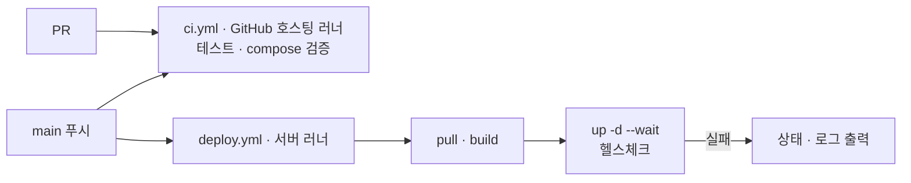

# 배포

main에 반영되면 배포 서버(macOS Apple Silicon, `baki-macbookpro`)의 self-hosted runner가 저장소를 받아 `docker compose`로 빌드하고 띄운다. 이미지 레지스트리는 쓰지 않는다.



| 파일 | 역할 |
| --- | --- |
| `infra/compose.yaml` | 서비스 정의. 지금은 postgres(PostGIS), vectordb(pgvector), redpanda |
| `infra/.env.example` | 서버 `.env` 양식 |
| `infra/runner/install-macos.sh` | 서버에 러너 설치 + launchd 서비스 등록 |
| `.github/workflows/ci.yml` | PR·main 검사 (GitHub 호스팅 러너) |
| `.github/workflows/deploy.yml` | main 배포 (서버 러너, `seoul-bike` 라벨) |

## 서버 최초 설정 (한 번)

1. Docker Desktop 설치, 로그인 시 자동 실행 켜기
2. 러너 설치: 등록 토큰을 받아 실행한다 (토큰 받는 법은 스크립트 상단 주석)
   ```bash
   git clone https://github.com/HuitaePark/skala_seoul_bike.git && cd skala_seoul_bike
   bash infra/runner/install-macos.sh <등록 토큰>
   ```
3. 비밀값 파일
   ```bash
   cp infra/.env.example ~/seoul-bike/.env && chmod 600 ~/seoul-bike/.env   # 값 수정
   ```
4. 잠자기 방지: `sudo pmset -c sleep 0`

## 배포하기

- **자동:** `infra/`, `services/`, `packages/`, `apps/`, `deploy.yml`이 바뀐 커밋이 main에 들어오면 실행된다.
- **수동:** Actions → deploy → Run workflow.

서비스를 추가하면 `infra/compose.yaml`에 `build:`와 `healthcheck`를 넣는다. `--wait`가 헬스체크 통과까지 기다리므로, 헬스체크가 없으면 배포 성공 여부를 알 수 없다.

## 보안

저장소가 공개라서 서버 러너를 다음처럼 막아 둔다.

- `deploy.yml`은 `push`(main)와 수동 실행만 받는다. `pull_request`로는 서버 러너가 돌지 않는다.
- 외부 기여자의 PR 워크플로는 저장소 관리자가 승인해야 실행된다 (Settings → Actions → Fork pull request workflows: 모든 외부 기여자 승인 필요).
- `production` 환경은 main 브랜치에서만 배포할 수 있다.
- 비밀값은 서버의 `~/seoul-bike/.env`에만 둔다. GitHub Secrets에 넣지 않는다.

## 문제 해결

| 증상 | 확인 |
| --- | --- |
| 배포 잡이 `Waiting for a runner`에서 멈춤 | 서버가 잠자기 상태인지, `~/actions-runner-seoul-bike/svc.sh status` |
| `docker: command not found` | 러너 폴더의 `.path`에 `/usr/local/bin`이 있는지, Docker Desktop이 켜져 있는지 |
| `.env가 없다` 오류 | `~/seoul-bike/.env` 존재와 권한(600) |
| `--wait` 시간 초과 | 잡 로그의 "실패 시 상태와 로그" 단계 |
