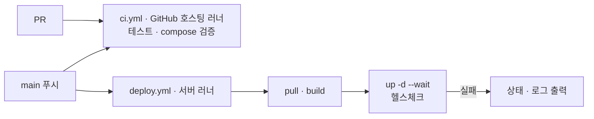

# 배포

main에 반영되면 배포 서버(macOS Apple Silicon, `baki-macbookpro`)의 self-hosted runner가 저장소를 받아 `docker compose`로 빌드하고 띄운다. 이미지 레지스트리는 쓰지 않는다.



| 파일 | 역할 |
| --- | --- |
| `infra/compose.yaml` | 서비스 정의: frontend(nginx + Vue, :3000 공개), backend(Spring Boot, :8080), postgres(PostGIS), vectordb(pgvector), redpanda |
| `infra/.env.example` | 로컬 실행용 `.env` 양식. 서버 `.env`는 배포가 GitHub `production` 환경 값으로 만든다 |
| `infra/runner/install-macos.sh` | 서버에 러너 설치 + launchd 서비스 등록 |
| `.github/workflows/ci.yml` | PR·main 검사 (GitHub 호스팅 러너) |
| `.github/workflows/deploy.yml` | main 배포 (서버 러너, `seoul-bike` 라벨) |

## 서버 최초 설정 (한 번)

현재 서버: `bakillm@baki-macbookpro` (Tailscale `100.109.172.112`), CPU 10코어 · 메모리 16GB. 화면 없이 SSH로 관리하므로 Docker Desktop 대신 Colima를 쓴다.

1. Homebrew 설치 (관리자 비밀번호 필요, 개발자 도구 포함)
2. Docker 런타임: Colima를 로그인 시 자동 실행 서비스로 띄운다
   ```bash
   brew install colima docker docker-compose docker-buildx
   mkdir -p ~/.docker/cli-plugins
   ln -sfn /opt/homebrew/opt/docker-compose/bin/docker-compose ~/.docker/cli-plugins/docker-compose
   ln -sfn /opt/homebrew/opt/docker-buildx/bin/docker-buildx ~/.docker/cli-plugins/docker-buildx
   colima start --cpu 6 --memory 8 --disk 100 --vm-type vz --vz-rosetta --mount-type virtiofs
   colima stop && brew services start colima
   ```
3. 러너 설치: 등록 토큰을 받아 실행한다 (토큰 받는 법은 스크립트 상단 주석)
   ```bash
   curl -fsSL https://raw.githubusercontent.com/HuitaePark/skala_seoul_bike/main/infra/runner/install-macos.sh | bash -s -- <등록 토큰>
   ```
4. 비밀값: 서버 `~/seoul-bike/.env`는 배포가 만든다 (아래 "비밀값"). 처음 설치할 때는 GitHub `production` 환경에 secret을 먼저 넣는다. 비밀번호는 `openssl rand -hex 24`로 만든다.
5. 잠자기 방지: `pmset`에 `disablesleep 1`과 전원 연결 시 `sleep 0`이 설정돼 있어 **덮개를 닫아도 잠들지 않는다.** 보조로 `~/Library/LaunchAgents/com.seoulbike.caffeinate.plist`가 `caffeinate -s`를 상시 실행한다. 덮개를 닫은 채 부하가 크면 발열이 커지므로 통풍되는 곳에 둔다.

같은 서버에서 Ollama(`com.baki.ollama-server`, `100.109.172.112:11434`)도 돈다. 모델을 올리면 메모리를 쓰므로 Colima 메모리(8GB)와 합이 16GB를 넘지 않게 본다.

접속 주소:

| 주소 | 범위 | 비고 |
| --- | --- | --- |
| `https://baki-macbookpro.tail3286a4.ts.net` | **인터넷 공개** (Tailscale Funnel 443 → frontend :3000) | 팀원·발표 데모용 기본 주소. 화면과 `/api`, `/swagger`, `/status`가 모두 여기로 열린다 |
| `https://baki-macbookpro.tail3286a4.ts.net:8443` | 인터넷 공개 (같은 frontend) | 예전 링크 호환용. 학교·회사 유선망은 8443을 막을 수 있으니 443 주소를 쓴다 |
| `http://baki-macbookpro.tail3286a4.ts.net:8080` | Tailscale 네트워크, 서버가 연결된 공유기 내부망 | Colima가 모든 인터페이스에 포트를 연다 |
| `https://baki-macbookpro.tail3286a4.ts.net:10443` | Tailscale 네트워크만 | Ollama(11434) |

Funnel 관리 (서버에서, CLI는 `/Applications/Tailscale.app/Contents/MacOS/Tailscale`):

```bash
Tailscale funnel status                                          # 현재 설정
Tailscale funnel --bg --https=443 http://127.0.0.1:3000          # 공개 (frontend)
Tailscale funnel --https=443 off                                 # 공개 중단 (8443도 같은 방식)
```

## 배포하기

- **자동:** compose가 빌드하는 폴더(`infra/`, `backend/`, `frontend/`, `agent/`, `business-mcp/`, `rag-mcp/`), `docs/specs/`, `docs/evidence/`, `deploy.yml`이 바뀐 커밋이 main에 들어오면 실행된다. 새 서비스를 넣으면 `deploy.yml`의 `paths`에도 넣는다.
- **수동:** Actions → deploy → Run workflow.

서비스를 추가하면 `infra/compose.yaml`에 `build:`와 `healthcheck`를 넣는다. `--wait`가 헬스체크 통과까지 기다리므로, 헬스체크가 없으면 배포 성공 여부를 알 수 없다.

## 보안

저장소가 공개라서 서버 러너를 다음처럼 막아 둔다.

- `deploy.yml`은 `push`(main)와 수동 실행만 받는다. `pull_request`로는 서버 러너가 돌지 않는다.
- 외부 기여자의 PR 워크플로는 저장소 관리자가 승인해야 실행된다 (Settings → Actions → Fork pull request workflows: 모든 외부 기여자 승인 필요).
- `production` 환경은 main 브랜치에서만 배포할 수 있다.
- 비밀값은 **`production` 환경 secret**에만 둔다 (저장소 secret 아님). 저장소 secret은 어느 브랜치의 워크플로든 읽을 수 있지만, 환경 secret은 main에서 도는 배포 잡만 읽는다.
- 주의: main은 보호돼 있지 않아 쓰기 권한이 있는 팀원은 `deploy.yml`을 고쳐 secret을 꺼낼 수 있다. 외부인과 다른 브랜치만 막는다.

## 비밀값

서버 `~/seoul-bike/.env`는 **배포할 때마다 GitHub `production` 환경의 secret·variable로 새로 쓴다** (`deploy.yml` "서버 .env 만들기"). 서버에서 손으로 고치지 않는다. 고쳐도 다음 배포에서 덮인다.

| 종류 | 이름 | 비고 |
| --- | --- | --- |
| secret (필수) | `POSTGRES_PASSWORD`, `VECTOR_PASSWORD`, `JWT_SECRET` | 없으면 배포가 멈춘다. DB 비밀번호는 기존 볼륨과 같아야 한다 |
| secret | `SEED_USER_PASSWORD`, `INTERNAL_TOKEN`, `OLLAMA_API_KEY` | 비우면 시연 계정 없음 · `/internal` 토큰 없음 · LLM 없음 |
| variable | `POSTGRES_DB`, `POSTGRES_USER`, `VECTOR_DB`, `VECTOR_USER`, `FAKE_AGENT_ENABLED`, `MCP_INTERNAL_MODE`, `AGENT_LLM`, `MCP_FAKE`, `OLLAMA_HOST` | 비우면 compose 기본값 |

- 넣기·바꾸기 (저장소 관리자만): `gh secret set 이름 --env production` (값을 물어볼 때 붙여 넣는다. 채팅·PR에 값을 남기지 않는다), `gh variable set 이름 --env production --body 값`
- 바꾼 값은 **다음 배포부터** 들어간다. 바로 넣으려면 Actions → deploy → Run workflow.
- 새 변수를 compose에 쓰면 `deploy.yml`의 `env`와 목록에도 넣는다.

## 문제 해결

| 증상 | 확인 |
| --- | --- |
| 배포 잡이 `Waiting for a runner`에서 멈춤 | 서버가 잠들었는지, 덮개가 닫혔는지, `~/actions-runner-seoul-bike/svc.sh status` |
| `docker: command not found` · 소켓 연결 실패 | `brew services list`에서 colima가 started인지, 러너 폴더 `.path`에 `/opt/homebrew/bin`이 있는지 |
| `production 환경 secret …가 없다` 오류 | Settings → Environments → production에 그 secret이 있는지 (아래 "비밀값") |
| `--wait` 시간 초과 | 잡 로그의 "실패 시 상태와 로그" 단계 |
